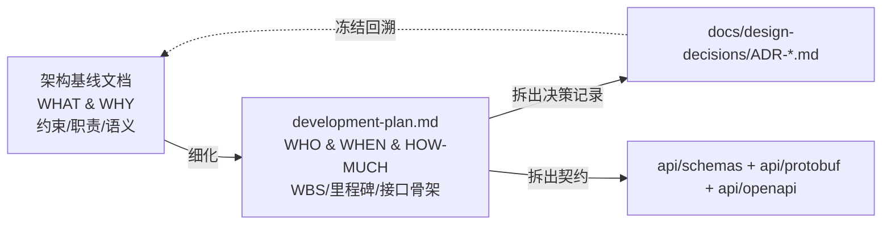
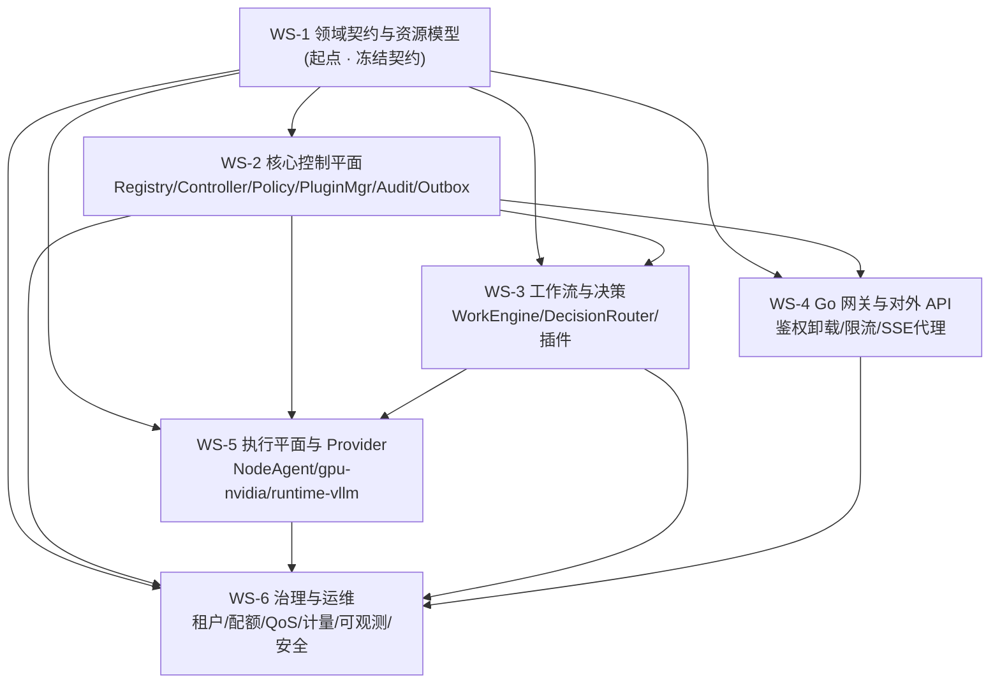
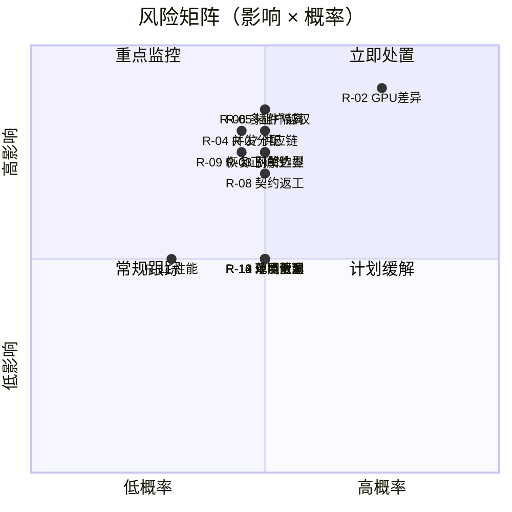

# ForgeMesh 开发计划（Development Plan）

> **状态说明（2026-10-11）**：本计划描述的 M0–M6 已于 v1.0.0 全部交付（见 [CHANGELOG](../../CHANGELOG.md) 与 [v1.0 发布记录](../releases/v1.0.md)）。v1.0.1 修订与 v1.1 可信基线计划见 [v1.1-development-plan.md](v1.1-development-plan.md)；模块与真实代码路径的映射见 [module-mapping.md](module-mapping.md)；1.1.0 之后的路线图见 [roadmap.md](roadmap.md)。本文其余内容保留为历史规划基线，不再要求重复实施。

> Development Plan · v2.0 · 2026-10-10 · 派生自上游架构基线文档《ForgeMesh 最终版架构设计文档.md》（v1.0）

本文件是上游架构基线文档《ForgeMesh 最终版架构设计文档.md》（待纳入仓库后落盘为 `docs/architecture/architecture.md`）的**工程落地细化**，把 20 章、116KB 的架构设计转化为可排期、可分工、可验收的开发计划。全文以表格与接口伪代码为主，力求"具体到可落地"。

---

## 目录

- [第 0 章 文档信息](#第-0-章-文档信息)
- [第 1 章 计划总览](#第-1-章-计划总览)
- [第 2 章 并行工作流编排（Workstreams）](#第-2-章-并行工作流编排workstreams)
- [第 3 章 四级 WBS 拆解](#第-3-章-四级-wbs-拆解)
- [第 4 章 里程碑与依赖](#第-4-章-里程碑与依赖)
- [第 5 章 接口契约（接口伪代码）](#第-5-章-接口契约接口伪代码)
- [第 6 章 关键 YAML 示例](#第-6-章-关键-yaml-示例)
- [第 7 章 数据模型与迁移](#第-7-章-数据模型与迁移)
- [第 8 章 测试与验收标准](#第-8-章-测试与验收标准)
- [第 9 章 风险与缓解](#第-9-章-风险与缓解)
- [第 10 章 任务总表（可导入 issue tracker）](#第-10-章-任务总表可导入-issue-tracker)

---

## 第 0 章 文档信息

### 0.1 文档元数据

| 项 | 内容 |
| --- | --- |
| 文档名称 | ForgeMesh 开发计划（Development Plan） |
| 版本 | **v2.0（V2）** |
| 状态 | **Draft（待终审）** —— V1 经任务 #2 评审，V2 已闭环 1 阻断 + 8 重要 + 9 建议（见文末变更记录）；待任务 #4 终审 |
| 日期 | 2026-10-10 |
| 作者 | 架构师-江城（技术方案作者 / Tech Lead 视角） |
| 上游唯一事实来源 | 上游架构基线文档《ForgeMesh 最终版架构设计文档.md》（v1.0，1296 行 / 20 章；待纳入仓库后落盘为 `docs/architecture/architecture.md`） |
| 交付物范围 | **仅本文档**；本任务不产出任何业务代码 |
| 目标读者 | 团队 Leader、Tech Lead、各工作流 Owner、评审者、SRE/安全、社区贡献者 |
| 维护方式 | 与本文件同目录的 ADR 目录共同演进；接口冻结点之后变更须提 ADR（见第 4 章） |
| 关联产物 | 上游架构基线文档（落盘为 `docs/architecture/architecture.md`）、`docs/design-decisions/`（ADR）、`docs/api/`（OpenAPI/Protobuf）、`api/schemas/` |

### 0.2 与上游架构基线文档的关系



- **上游架构基线文档定义"是什么/为什么"**：目标、ADR、4 条不变量、6 层架构、模块职责边界、运行语义。
- **本文档定义"谁做/何时做/做到什么程度"**：四级 WBS、里程碑 M0–M6、接口伪代码骨架、验收标准、风险。
- **冲突处理**：以上游架构基线文档为准；本文档不得与 12 项 ADR、4 条不变量矛盾。若发现矛盾，须提 ADR 修订或回改本文档。
- **术语说明**：本文档中出现的 "architecture.md" 均指上游架构基线文档《ForgeMesh 最终版架构设计文档.md》，待纳入仓库后落盘为 `docs/architecture/architecture.md`。

### 0.3 术语表

| 术语（中/英） | 含义 |
| --- | --- |
| ADR（架构决策记录） | Architecture Decision Record，本项目 **ADR-001 ~ ADR-012** 已采纳（见 1.2） |
| 架构不变量（Invariant） | 4 条不可违背的约束（见 1.2） |
| 资源对象（Resource Object） | 具 `apiVersion/kind/metadata/spec/status` 的声明式对象（如 `InferenceService`） |
| 期望状态 / 实际状态 | Desired State（`spec`）/ Observed State（`status`） |
| 协调控制器（Reconciliation Controller） | 持续比较期望与实际状态并生成协调计划的组件（9 步闭环，见 5.3） |
| WorkEngine / 工作流运行时 | 持久化、可恢复地执行有边界工作流的系统（契约见 5.4） |
| JEV（TypeSafe Decision Model） | 类型化决策模型；**不是**唯一决策后端，也不是授权系统 |
| Decision Router | 决策 Provider 的选择、超时、熔断、降级与输出校验（见 5.5） |
| Policy Engine | 授权/准入/配额规则/审批要求；**决策≠授权** |
| Scheduler | 资源可行性、分配、冲突与释放；拥有最终资源分配权 |
| Plugin（插件） | 通过稳定契约扩展能力；按信任级别隔离（见 5.7） |
| Node Agent | 节点侧受控执行组件（协议见 5.9） |
| Milestone（里程碑） | M0–M6，阶段级交付检查点（见 1.3/第 4 章） |
| WS（Workstream，工作流） | 6 条并行工程工作流 WS-1 ~ WS-6（见第 2 章） |
| WP（Work Package，工作包） | WBS 第 2 级，如 `WP-1.3` |
| Task（任务） | WBS 第 3 级，天级粒度，如 `T-1.3.1` |
| Subtask（原子子任务） | WBS 第 4 级，2–4 小时可执行粒度，如 `ST-1.3.1.1` |
| DoD（完成的定义） | Definition of Done，可验证的完成标准 |
| 契约冻结（Contract Freeze） | 某里程碑后公共接口不再破坏性变更，变更须 ADR（见 4.4） |
| 事务性 Outbox | 与业务写入同事务落库的待发布事件表（ADR-008） |
| 租户（Tenant） | 身份/资源/工作流/数据/计量的隔离边界 |

### 0.4 文档约定

| 约定 | 规则 |
| --- | --- |
| ID 编码 | 里程碑 `M0–M6`；阶段 `P0–P5`；工作流 `WS-1–WS-6`；工作包 `WP-{阶段}.{序号}`；任务 `T-{阶段}.{包}.{序号}`；原子子任务 `ST-{阶段}.{包}.{任务}.{序号}` |
| 估时单位 | 人日（person-day, pd），1 pd = 8h；原子子任务 2–4h（≈0.25–0.5 pd） |
| 优先级 | P0（阻塞关键路径）/ P1（重要）/ P2（可延后） |
| 角色代号 | TL（Tech Lead）、DC（领域契约）、CP（控制平面）、WF（工作流决策）、GW（Go 网关）、AG（Agent/Provider）、SRE（治理与运维） |
| 语言约定 | 核心语言 Python；对外高性能网关/流式代理 Go；Agent RPC gRPC/Protobuf |
| 代码语言标记 | 伪代码块不保证可运行，仅为接口签名与语义约定 |

---

## 第 1 章 计划总览

### 1.1 交付目标与非目标

**本计划的目标（In Scope）**

| # | 目标 | 对齐 architecture.md |
| --- | --- | --- |
| G1 | 把架构基线拆成阶段 P0–P5、里程碑 M0–M6、四级 WBS，覆盖全部 10 个 packages 与 7 个 plugins | 第 16/17/19 章 |
| G2 | 冻结 12 项 ADR 与 4 条不变量的落地方式，使每个 ADR 有对应的任务与测试用例 | 第 2.1/2.2/18.2 章 |
| G3 | 明确 6 条并行工作流（WS-1~WS-6）的边界、接口契约与依赖，实现"接口冻结 + 协作契约" | 第 3/4 章 |
| G4 | 给出关键接口伪代码（Python Pydantic/Protocol、Go interface、Protobuf），可直接转写为代码 | 第 5/6/10/13 章 |
| G5 | 给出可执行的验证标准：测试分层、10 条不变量测试矩阵、每阶段 DoD | 第 18/20 章 |

**本计划明确排除的内容（Out of Scope，对齐 architecture.md 第 1.3 节）**

| # | 非目标 | 说明 |
| --- | --- | --- |
| N1 | 不实现 GPU 驱动 / 通用容器运行时 | 复用生态 |
| N2 | 不重写 vLLM 等推理引擎 | 以 Provider 适配 |
| N3 | 不把 Kubernetes 作为唯一执行后端 | 执行后端可替换 |
| N4 | 不要求所有插件同进程 | 分级隔离（ADR-006） |
| N5 | 不要求所有决策由 JEV/LLM 完成 | 支持规则/JEV/LLM Provider（ADR-004） |
| N6 | 不让 LLM/JEV 绕过权限、配额、调度、安全检查 | 不变量三 |
| N7 | 阶段 0–3 不追求"全厂商 GPU / 全工作流引擎 / 全 Runtime 同时支持" | 分阶段扩展 |
| N8 | **本任务不产出任何业务代码**，仅本开发计划文档 | 硬约束 1 |

### 1.2 架构约束速览

#### 1.2.1 12 项 ADR 及其对开发计划的约束

| ADR | 决策 | 架构约束 | **对开发计划的约束（本计划落点）** |
| --- | --- | --- | --- |
| ADR-001 | 微内核与插件分离 | 核心定义稳定契约，插件实现能力 | 核心 packages 先冻结契约（WS-1）；插件仅依赖 SDK，禁止反向依赖核心内部实现。落点：WP-0.2、WP-1.5、WP-4.6 |
| ADR-002 | 声明式资源模型 | Desired 与 Observed 分离 | `spec/status` 分字段、`generation/observedGeneration`、`conditions`。落点：5.1、WP-0.1 |
| ADR-003 | WorkEngine 可替换 Provider | 执行引擎不决定领域模型 | 先定义 `WorkflowRuntime` 契约再选执行器；业务模型不引入引擎内部类型。落点：5.4、WP-2.1/2.2 |
| ADR-004 | JEV 不是唯一决策系统 | 支持规则/JEV/LLM 等 Provider | `DecisionRouter` 多 Provider；规则 Provider 为首个确定性实现。落点：5.5、WP-2.3/2.4 |
| ADR-005 | Scheduler/Policy 拥有最终治理权 | 决策建议不能直接分配资源或授权 | 决策输出**必须**经 Policy→Scheduler；禁止 JEV 写资源终态。落点：5.6、WP-1.4、不变量三测试 |
| ADR-006 | 插件按信任级别隔离 | 高风险/第三方插件隔离执行 | 定义进程内 vs 受限 RPC 两种宿主模式；权限最小化。落点：5.7、WP-0.3、WP-4.6 |
| ADR-007 | PostgreSQL 为权威业务存储 | 缓存/事件不能取代权威状态 | 所有资源权威态落 PG；Redis 仅缓存/限流。落点：第 7 章、WP-1.2 |
| ADR-008 | 事务性 Outbox + 幂等消费者 | 关键事件禁止非原子双写 | 状态更新与事件写入同事务；消费者按 event_id 去重。落点：5.3、WP-1.6 |
| ADR-009 | Node Agent 受认证任务协议 | 禁止默认执行任意远程 Shell | 仅接受有类型任务；无 `RunShell` 类型。落点：5.9、WP-3.2 |
| ADR-010 | 能力驱动异构资源模型 | 厂商差异通过 Provider 显式表达 | `DeviceProfile` 表达能力；不强行统一硬件行为。落点：5.1、WP-5.1 |
| ADR-011 | 插件与工作流版本固定 | 升级不破坏运行中任务 | 运行实例记录定义/插件版本；升级期间新旧版并存。落点：WP-2.1、WP-4.6 |
| ADR-012 | 公共契约版本化 | Schema/兼容性测试/弃用周期 | 所有 API/Schema/事件/插件协议带版本前缀；Contract 测试。落点：WP-0.5、第 8 章 |

#### 1.2.2 4 条架构不变量及其落地线索

| 不变量 | 内容 | 对开发计划的约束 | 验证任务 |
| --- | --- | --- | --- |
| INV-1 | 核心掌握状态与治理权：插件可执行操作，但不能绕过核心直接改变其他模块权威状态 | 插件只能通过核心接口提交类型化请求；无直连 DB 写权威表。落点 5.7、WP-1.5 | 8.2 矩阵 #7、#8 |
| INV-2 | 目标状态与执行过程分离：是否/达到何状态由资源+控制器定，如何执行由 WorkEngine 负责 | Controller 只生成计划不下发节点命令；WorkEngine 不写资源终态。落点 5.3/5.4 | 8.2 矩阵 #1、#5 |
| INV-3 | 决策不等于授权：JEV 可推荐候选，但策略与资源可行性检查不可跳过 | Decision 输出强制经 Policy/Scheduler。落点 5.5/5.6 | 8.2 矩阵 #2 |
| INV-4 | 关键状态必须可恢复和追溯：每次分配/执行/决策/插件调用有稳定标识、版本、可查询结果 | 全链路 `correlation_id`+版本字段+审计。落点 5.3/5.4、WP-1.6、WP-4.4 | 8.2 矩阵 #5、#6、#10 |

#### 1.2.3 6 层架构（L1–L6）→ 工作流/落点映射

| 层 | 名称 | 职责（架构 3.1） | 主责 WS | 关键落点（章节 / WP / 任务） |
| --- | --- | --- | --- | --- |
| L1 | Access Layer | REST API · CLI · Web Console · SDK；统一入口、认证、API 兼容 | WS-4（GW 主）、WS-2（支撑） | 5.8 网关接口；API **骨架/OpenAPI** 由 WS-4 交付、**业务实现**归 WS-2（T-1.7.1，见 S-04）；T-1.7.2 CLI；T-1.8.x 网关 |
| L2 | Core Control Plane | Resource Registry · Reconciliation · Policy · Scheduler · Plugin Manager · Audit | WS-2 | WP-1.1~1.7（5.2/5.3/5.6） |
| L3 | Orchestration & Decision | WorkEngine API · Decision Router · JEV API · Workflow Providers | WS-3 | WP-2.1~2.6（5.4/5.5） |
| L4 | Plugin Capability Layer | GPU · Runtime · Model · MIG · Quantization · QoS · Metering | WS-3/WS-5/WS-6 | 决策/工作流插件 @WS-3、gpu/runtime @WS-5、qos/metering @WS-6（7 个 plugin 粒度见下） |
| L5 | Execution Plane | Node Agent · Kubernetes · Container Runtime · GPU · Inference Services | WS-5 | WP-3.1/3.2（5.9）、WP-3.3/3.4 |
| L6 | Platform Infrastructure | PostgreSQL · Outbox/Event Bus · Object Storage · **Secret Manager** · Observability | WS-2/WS-6 | 第 7 章 DDL、WP-1.6 Outbox、**T-1.2.3 Secret Manager**、T-4.4.x 观测 |

**L4 插件粒度映射（7 个 plugin）**

| 插件 | 类别 | WS | 落点任务 |
| --- | --- | --- | --- |
| decision-rules | Provider/决策 | WS-3 | T-2.4.1 |
| decision-jev | Provider/决策 | WS-3 | T-2.4.2 |
| workflow-reference | Provider/工作流 | WS-3 | T-2.5.1 |
| gpu-nvidia | Hardware（含 MIG） | WS-5 | WP-3.3 / T-5.1.1 |
| runtime-vllm | Runtime | WS-5 | WP-3.4 |
| qos-basic | Policy/QoS | WS-6 | T-4.3.1 |
| metering-basic | Observability/计量 | WS-6 | T-4.3.2 |

### 1.3 路线图总览：阶段 P0–P5 → 里程碑 M0–M6

架构文档第 19 章的阶段 0–5 映射为里程碑 M0–M6。**M0 为计划锚点/环境就绪，M1 起为阶段交付里程碑。**

| 里程碑 | 对应阶段 | 定义 | 准入条件（Entry） | 准出条件（Exit / DoD） |
| --- | --- | --- | --- | --- |
| **M0** | 预阶段 | 项目启动与工程基线就绪 | 架构基线 v1.0 评审通过 | 仓库/CI/代码规范/ADR 模板/Go+Python 骨架可构建；本开发计划 V2 终审通过 |
| **M1** | P0 架构与领域契约 | 领域契约与公共接口冻结 | M0 达成 | 资源模型/Schema/状态机/Registry/Controller/WorkEngine/Decision/Policy/Scheduler 接口冻结并可编译；威胁模型与权限模型就绪；契约测试框架可跑通 |
| **M2** | P1 核心控制平面 | 控制平面可用（声明式闭环离线可跑） | M1 达成 | Registry 权威态+乐观并发；Controller 9 步闭环幂等；Policy/Plugin Manager/Audit/Outbox 可用；REST API+CLI+Go 网关可联通 |
| **M3** | P2 工作流与决策 | 可靠执行与结构化决策 | M2 达成 | WorkEngine 参考执行器支持持久化/幂等/重试/取消/补偿/审批/恢复；Decision Router 降级；decision-rules/jev、workflow-reference 插件通过契约测试 |
| **M4** | P3 执行平面与 GPU 生命周期 | 端到端 GPU 上线闭环 | M3 达成 | Node Agent 认证协议+任务幂等+断线恢复；gpu-nvidia、runtime-vllm 插件可用；从 GPU 发现到推理服务验收 E2E 通过；故障恢复测试通过 |
| **M5** | P4 生产级治理 | 生产级多租户治理 | M4 达成 | 配额/QoS/Token 计量；可观测三件套+诊断包；插件签名/隔离/升级兼容；安全测试与灾备演练通过 |
| **M6** | P5 扩展与生态 | 生态与稳定发布 | M5 达成 | MIG/异构 Provider；多 Runtime/Workflow Provider；插件 SDK+开发者认证；社区治理与稳定 API 发布 |

### 1.4 时间线：甘特概览与关键路径

**时间轴（周为单位，W0 起；5–8 人并行）**

| 周 | W1 | W2 | W3 | W4 | W5 | W6 | W7 | W8 | W9 | W10 | W11 | W12 | W13 | W14 | W15 | W16 | W17 | W18 | W19 | W20 | W21 | W22 | W23 | W24 |
| --- | --- | --- | --- | --- | --- | --- | --- | --- | --- | --- | --- | --- | --- | --- | --- | --- | --- | --- | --- | --- | --- | --- | --- | --- |
| P0 契约 | █ | █ | █ | | | | | | | | | | | | | | | | | | | | | |
| P1 控制平面 | | | █ | █ | █ | █ | █ | | | | | | | | | | | | | | | | | |
| P2 工作流决策 | | | | | █ | █ | █ | █ | █ | | | | | | | | | | | | | | | |
| P3 执行平面 GPU | | | | | | | | █ | █ | █ | █ | █ | █ | | | | | | | | | | | |
| P4 生产治理 | | | | | | | | | | | | █ | █ | █ | █ | █ | █ | | | | | | | |
| P5 生态 | | | | | | | | | | | | | | | | | | █ | █ | █ | █ | █ | █ | █ |
| **里程碑** | M0 | | M1 | | | | | M2 | | | | M3 | | | | M4 | | | | M5 | | | | M6 |

> 说明：各工作流存在重叠并行（如 WS-4 Go 网关在 P1 内落地、WS-1 契约在 P0 冻结），上表为阶段主窗口，非独占。
>
> **里程碑缓冲注记**：表中里程碑 M2/M3/M4/M5 分别标注于 W8/W12/W16/W20，晚于其所属阶段主窗口结束（P1 止 W7、P2 止 W9、P3 止 W13、P4 止 W17）**1–3 周**。该差值即**集成/验收缓冲（Integration & Acceptance Buffer）**，用于跨 WS 联调、契约回归与硬件环境对齐，并非排版误差；里程碑仅在对应阶段 DoD 全绿后达成，缓冲不改变阶段归属。

**关键路径（Critical Path）**

```
M0
 └─> Contracts: 资源模型(5.1) → Registry(5.2) → Controller(5.3)      [WS-1 → WS-2]
      └─> WorkflowRuntime(5.4) → 参考执行器                          [WS-3]
           └─> Node Agent 协议(5.9) → gpu-nvidia → runtime-vllm     [WS-5]
                └─> E2E: GPU发现 → 上线 → 验收 → 回收                [跨 WS]
                     └─> 租户/配额/计量 收口 → 发布                  [WS-6]
```

关键路径节点：**5.1 → 5.2 → 5.3 → 5.4 → 5.9 → gpu-nvidia/runtime-vllm → E2E → 治理 → M6**。
并行可切分点：Go 网关（WS-4）、多租户治理（WS-6）、文档/CLI 可与主链并行。

### 1.5 团队编制（5–8 人）与人力映射

| 代号 | 角色 | 5 人档 | 7–8 人档 | 主责 | 关键交付 |
| --- | --- | --- | --- | --- | --- |
| TL | Tech Lead / 架构守门人 | 1 | 1 | 契约裁决、ADR、跨流协调、终审 | ADR、契约冻结、方案对齐 |
| DC | 契约与领域模型工程师 | 1 | 1 | core-contracts / resource-model / api schemas | 5.1/5.2、Schema、契约测试 |
| CP | 控制平面工程师 | 1（兼 WF） | 1 | Registry/Controller/Policy/Plugin Manager/Audit/Outbox | WP-1.x |
| WF | 工作流与决策工程师 | 0（由 CP 兼） | 1 | workflow-api/runtime、decision-api、决策与工作流插件 | WP-2.x |
| GW | Go 网关工程师 | 1 | 1 | Go gateway、OpenAPI、流式代理 | WP-1.8、5.8 |
| AG | Agent / Provider 工程师 | 1（兼 SRE） | 1 | node-agent、gpu-nvidia、runtime-vllm | WP-3.x、WP-5.1 |
| SRE | SRE / 安全 / 治理工程师 | 0（由 AG 兼） | 1 | 租户/配额/QoS/计量/观测/安全/发布 | WP-4.x、WP-0.3 |
| MOB | 机动工程师（可选） | 0 | 0–1 | 补强 CP/WF/AG 之一 | 关键路径支援 |
| **合计** | — | **5** | **7–8** | — | — |

**人数规则（任一配置均 ≤8 人）**

- **5 人档 = TL + DC + CP（兼 WF）+ AG（兼 SRE）+ GW = 5 人**（GW 亦可与 DC 互备）。
- **7 人档 = TL + DC + CP + WF + GW + AG + SRE = 7 人**（基准全角色各 1）。
- **8 人档 = 7 人档 + 1 名机动（MOB）**，机动仅允许落在 **CP 或 WF 或 AG 三者之一**，总数不超过 8。
- **不存在"CP、WF、AG 各 2 人"的配置**；若出现同类加人需求超出 8 人，须走范围裁剪或工期调整，不得突破 5–8 人约束。

**6 条工作流 → 人力映射**

| 工作流 | 主责角色 | 备用角色 | 阶段覆盖 |
| --- | --- | --- | --- |
| WS-1 领域契约与资源模型 | DC | TL | P0–P5 |
| WS-2 核心控制平面 | CP | DC | P0–P4 |
| WS-3 工作流与决策 | WF | CP | P0–P5 |
| WS-4 Go 网关与对外 API | GW | CP | P0–P5 |
| WS-5 执行平面与 Provider | AG | SRE | P0–P5 |
| WS-6 治理与运维 | SRE | CP | P0–P5 |

---

## 第 2 章 并行工作流编排（Workstreams）

本章定义 6 条并行工作流（WS-1 ~ WS-6）。每条工作流有明确 Owner、输入/输出、覆盖 packages、里程碑与冻结的接口契约。**"接口冻结 + 协作契约"是本计划的核心协作机制**：跨 WS 的交互只允许通过已冻结接口进行，任何接口变更须走 ADR。

### 2.1 工作流总览

| WS | 名称 | Owner | 覆盖 packages | 覆盖 plugins | 主要里程碑 |
| --- | --- | --- | --- | --- | --- |
| WS-1 | 领域契约与资源模型 | DC | `core-contracts`、`resource-model`、`api/schemas` | — | M1、M6 |
| WS-2 | 核心控制平面 | CP | `control-plane`、`policy-engine`、`plugin-sdk` | — | M2、M4 |
| WS-3 | 工作流与决策 | WF | `workflow-api`、`workflow-runtime`、`decision-api` | `decision-rules`、`decision-jev`、`workflow-reference` | M1、M3、M5 |
| WS-4 | Go 网关与对外 API | GW | Go gateway（`gateway/`）、`api/openapi`、`cli` | — | M2、M6 |
| WS-5 | 执行平面与 Provider | AG | `node-agent`、`api/protobuf` | `gpu-nvidia`、`runtime-vllm` | M4、M5 |
| WS-6 | 治理与运维 | SRE | （跨包关注点）、`deploy/` | `qos-basic`、`metering-basic` | M4、M5、M6 |

### 2.2 WS-1 领域契约与资源模型

| 项 | 内容 |
| --- | --- |
| 目标 | 冻结全局资源对象规范、强类型 Schema、状态机、公共接口（Registry/Controller/Workflow/Decision/Policy/Scheduler/Plugin/Agent 协议） |
| 负责角色 | DC（主）、TL（裁决） |
| 输入 | architecture.md 第 2/5/6/7/8/9/10/12/13 章 |
| 输出 | `api/schemas/*.json`、`packages/core-contracts/**`、`packages/resource-model/**`、接口签名与契约测试 |
| 依赖 | 无（起点）；被 WS-2/3/4/5/6 依赖 |
| 覆盖 packages | `core-contracts`、`resource-model`、`api/schemas` |
| 里程碑 | M1（冻结）、M6（稳定 API） |
| 冻结契约 | 资源对象 Schema、`ResourceRegistry`、`Reconciler`、`WorkflowRuntime`、`DecisionProvider`、`PolicyEngine`、`Scheduler`、`PluginManifest`、Node Agent Protobuf |

### 2.3 WS-2 核心控制平面

| 项 | 内容 |
| --- | --- |
| 目标 | 实现 Registry 权威状态、协调控制器 9 步闭环、Policy、Plugin Manager、Audit、Outbox |
| 负责角色 | CP（主）、DC（支撑） |
| 输入 | WS-1 冻结契约、PostgreSQL |
| 输出 | `packages/control-plane/**`、`packages/policy-engine/**`、`packages/plugin-sdk/**`、DDL 迁移 |
| 依赖 | WS-1（契约） |
| 覆盖 packages | `control-plane`、`policy-engine`、`plugin-sdk` |
| 里程碑 | M2（可用）、M4（治理收口） |
| 冻结契约 | Registry 存储语义、Controller 幂等去重键、Outbox 事件格式、Plugin 生命周期 |

### 2.4 WS-3 工作流与决策

| 项 | 内容 |
| --- | --- |
| 目标 | WorkEngine 运行契约+参考执行器、Decision Router+Provider 降级、审批与决策记录、工作流/决策插件 |
| 负责角色 | WF（主）、CP（支撑） |
| 输入 | WS-1 契约、Registry、Policy/Scheduler 接口 |
| 输出 | `packages/workflow-api/**`、`packages/workflow-runtime/**`、`packages/decision-api/**`、3 个插件 |
| 依赖 | WS-1（契约）、WS-2（Policy/Scheduler/Registry） |
| 覆盖 packages | `workflow-api`、`workflow-runtime`、`decision-api` |
| 里程碑 | M1（契约）、M3（可用）、M5（Temporal Provider 评估） |
| 冻结契约 | `WorkflowRuntime`、步骤状态机、`DecisionProvider`、`DecisionRouter` 降级策略 |

### 2.5 WS-4 Go 网关与对外 API

| 项 | 内容 |
| --- | --- |
| 目标 | Go 高性能 API 网关/流式代理：统一入口、鉴权卸载、限流边车、SSE/流式 Token 转发、协议/版本转换；OpenAPI 与 CLI |
| 负责角色 | GW（主）、CP（支撑） |
| 输入 | WS-1 OpenAPI/Protobuf、Python 控制平面 HTTP/gRPC 契约 |
| 输出 | `gateway/**`（Go）、`api/openapi/**`、`packages/cli/**` |
| 依赖 | WS-1（契约）；为 WS-2/3/5/6 提供外部入口 |
| 覆盖 packages | Go gateway、`cli`、`api/openapi` |
| 里程碑 | **M1 骨架、M2 可用（首期即引入，硬约束 2）**、M6 稳定 |
| 冻结契约 | 路由表、鉴权中间件、限流接口、StreamProxy 接口、探针/优雅停机 |

### 2.6 WS-5 执行平面与 Provider

| 项 | 内容 |
| --- | --- |
| 目标 | Node Agent（认证/任务幂等/断线恢复）、gpu-nvidia、runtime-vllm、端到端 GPU 生命周期、故障恢复 |
| 负责角色 | AG（主）、SRE（支撑） |
| 输入 | WS-1 Protobuf、WS-2 任务下发、WS-3 工作流步骤 |
| 输出 | `packages/node-agent/**`、`plugins/gpu-nvidia/**`、`plugins/runtime-vllm/**` |
| 依赖 | WS-1（协议）、WS-2（任务队列）、WS-3（工作流步骤） |
| 覆盖 packages | `node-agent`、`api/protobuf` |
| 里程碑 | M4（可用）、M5（异构/MIG） |
| 冻结契约 | Node Agent Protobuf、任务类型枚举、重连恢复语义 |

### 2.7 WS-6 治理与运维

| 项 | 内容 |
| --- | --- |
| 目标 | 多租户配额/QoS/计量、可观测三件套、诊断包、插件签名/隔离/升级、安全测试与灾备、qos-basic/metering-basic 插件 |
| 负责角色 | SRE（主）、CP（支撑） |
| 输入 | 全平台遥测、WS-2 Policy、WS-5 Agent 指标 |
| 输出 | `packages/**`（跨切面）、`deploy/**`、`plugins/qos-basic`、`plugins/metering-basic`、遥测/看板/诊断包 |
| 依赖 | WS-1~WS-5 |
| 覆盖 packages | 跨包（治理横切）、`deploy` |
| 里程碑 | M0（基建）、M4（初始）、M5（生产级）、M6（发布治理） |
| 冻结契约 | 计量口径、租户上下文传播、诊断包格式、插件信任级别 |

### 2.8 工作流依赖图



### 2.9 工作流依赖矩阵

行依赖列（✓ = 行依赖列；△ = 松耦合/接口级依赖）

| 依赖方 \ 被依赖 | WS-1 | WS-2 | WS-3 | WS-4 | WS-5 | WS-6 |
| --- | --- | --- | --- | --- | --- | --- |
| WS-1 契约 | — | | | | | |
| WS-2 控制平面 | ✓ | — | | | | |
| WS-3 工作流决策 | ✓ | ✓ | — | △ | | |
| WS-4 Go 网关 | ✓ | △ | △ | — | | |
| WS-5 执行平面 | ✓ | ✓ | ✓ | △ | — | |
| WS-6 治理运维 | ✓ | ✓ | ✓ | ✓ | ✓ | — |

### 2.10 协作契约约定

1. **接口优先**：任何跨 WS 交互先冻结接口（Python `Protocol` / Go `interface` / Protobuf），再各自实现。
2. **契约测试门禁**：WS-1 契约测试套件纳入 CI；WS-2~6 的 PR 必须通过契约测试方可合并。
3. **变更流程**：M1 冻结后，接口破坏性变更须提交 ADR 并经 TL 批准；非破坏性变更需在契约测试中显式登记。
4. **每日站会同步**：按"接口阻塞项"优先，而非进度汇报。
5. **集成点**：以 `correlation_id` 贯穿 WS-2/3/5 的调用链，作为跨 WS 联调的统一标识。

---

## 第 3 章 四级 WBS 拆解

本章按阶段 P0–P5 展开四级 WBS：**Phase（阶段）→ WP（工作包）→ Task（天级任务）→ Subtask（2–4h 原子子任务）**。每个阶段以一张表给出，并附阶段 DoD。

列含义：`WP-ID` 工作包编号 ｜ `Task-ID` 天级任务 ｜ `Subtask-ID` 原子子任务 ｜ `WS` 所属工作流 ｜ `依赖` 前置 ID ｜ `产出物` ｜ `DoD` 可验证完成标准。

### 3.1 阶段 P0：架构与领域契约（→ M1）

| WP-ID | 工作包 | Task-ID | 任务（天级） | Subtask-ID | 原子子任务（2–4h） | WS | 依赖 | 产出物 | DoD |
| --- | --- | --- | --- | --- | --- | --- | --- | --- | --- |
| WP-0.1 | 领域契约与资源模型 | T-0.1.1 | 核心资源对象基类与强类型 Schema（2d） | ST-0.1.1.1 | 定义 `ObjectMeta`/`ResourceBase[TSpec,TStatus]` 泛型基类 | WS-1 | M0 | `core-contracts/base.py` | 可实例化，字段与 architecture 5.1 对齐 |
| | | | | ST-0.1.1.2 | 定义 `generation/observedGeneration/conditions/resourceVersion` 语义 | WS-1 | ST-0.1.1.1 | 同上 + Schema | 单元测试覆盖字段语义 |
| | | | | ST-0.1.1.3 | 生成 JSON Schema 并纳入 `api/schemas/` | WS-1 | ST-0.1.1.2 | `api/schemas/*.json` | Schema 通过 meta 校验 |
| | | T-0.1.2 | `InferenceService` 强类型 spec/status（1.5d） | ST-0.1.2.1 | 定义 `InferenceServiceSpec`（model/runtime/resources/availability） | WS-1 | ST-0.1.1 | `resource-model/inference.py` | 示例 YAML 反序列化通过 |
| | | | | ST-0.1.2.2 | 定义 `InferenceServiceStatus`（phase/observedGeneration/conditions） | WS-1 | ST-0.1.2.1 | 同上 | 非法 phase 被拒绝 |
| | | T-0.1.3 | 节点/加速器/设备实例/设备档/分配/租约模型（2d） | ST-0.1.3.1 | `Node`/`Accelerator`/`DeviceInstance` Schema | WS-1 | ST-0.1.1 | `resource-model/device.py` | 与 architecture 9.1 实体一致 |
| | | | | ST-0.1.3.2 | `DeviceProfile`（能力驱动）Schema | WS-1 | ST-0.1.3.1 | 同上 | 能力字段可扩展 |
| | | | | ST-0.1.3.3 | `Allocation`/`ResourceLease`/`HealthReport` Schema | WS-1 | ST-0.1.3.1 | `resource-model/allocation.py` | 租约字段含 `lease_until` |
| | | T-0.1.4 | 资源状态机与 `conditions` 规范（1.5d） | ST-0.1.4.1 | 定义推理服务状态机枚举与合法转移 | WS-1 | ST-0.1.2 | `resource-model/state.py` | 非法转移抛错 |
| | | | | ST-0.1.4.2 | 定义标准 `Condition`（type/status/reason/message/lastTransition） | WS-1 | ST-0.1.4.1 | 同上 | 契约测试通过 |
| WP-0.2 | 公共接口契约冻结 | T-0.2.1 | `ResourceRegistry` 契约（1.5d） | ST-0.2.1.1 | 定义 `ResourceRegistry` Protocol（get/put/watch/list） | WS-1 | T-0.1.1 | `core-contracts/registry.py` | 类型检查通过 |
| | | | | ST-0.2.1.2 | 定义乐观并发（resourceVersion）语义与异常类型 | WS-1 | ST-0.2.1.1 | 同上 | 文档+单测 |
| | | T-0.2.2 | `Reconciler` 契约（1d） | ST-0.2.2.1 | 定义 9 步闭环 `Reconciler` 抽象与 `ReconcileResult` | WS-1 | T-0.2.1 | `core-contracts/reconciler.py` | 与 architecture 5.4 对齐 |
| | | | | ST-0.2.2.2 | 定义幂等去重键与并发约束接口 | WS-1 | ST-0.2.2.1 | 同上 | 键生成单测 |
| | | T-0.2.3 | `WorkflowRuntime` 抽象契约（1.5d） | ST-0.2.3.1 | 定义工作流/步骤状态机与转移校验接口 | WS-3 | T-0.2.2 | `workflow-api/runtime.py` | 与 architecture 6.3 对齐 |
| | | | | ST-0.2.3.2 | 定义幂等/重试/超时/取消/补偿/审批接口 | WS-3 | ST-0.2.3.1 | 同上 | 接口签名冻结 |
| | | T-0.2.4 | `DecisionProvider`/`DecisionRouter` 契约（1d） | ST-0.2.4.1 | 定义 `DecisionRequest`/`DecisionCandidate`/`DecisionProvider` | WS-3 | T-0.2.2 | `decision-api/provider.py` | 与 architecture 7.3 对齐 |
| | | | | ST-0.2.4.2 | 定义 Router 选择/超时/熔断/降级接口 | WS-3 | ST-0.2.4.1 | `decision-api/router.py` | 降级策略可配 |
| | | T-0.2.5 | `PolicyEngine`/`Scheduler` 契约（1d） | ST-0.2.5.1 | 定义 `PolicyDecision`（allow/deny/require_approval） | WS-2 | T-0.2.2 | `policy-engine/api.py` | 决策≠授权语义显式 |
| | | | | ST-0.2.5.2 | 定义 `ScheduleRequest`/`ScheduleResult` 与分配契约 | WS-2 | ST-0.2.5.1 | `core-contracts/scheduler.py` | 冲突返回可诊断 |
| WP-0.3 | 安全与治理基线 | T-0.3.1 | 威胁模型与信任边界（2d） | ST-0.3.1.1 | STRIDE 分析核心组件 | WS-6 | M0 | `docs/architecture/security.md` | 覆盖高风险操作清单 |
| | | | | ST-0.3.1.2 | 定义信任边界与缓解措施映射 | WS-6 | ST-0.3.1.1 | 同上 | 评审通过 |
| | | T-0.3.2 | 插件权限模型与隔离等级（1.5d） | ST-0.3.2.1 | 定义权限枚举与最小权限映射 | WS-2 | T-0.3.1 | `plugin-sdk/permissions.py` | 与 architecture 8.1 对齐 |
| | | | | ST-0.3.2.2 | 定义隔离等级（进程内/受限 RPC）判定规则 | WS-2 | ST-0.3.2.1 | 同上 | ADR-006 落点 |
| | | T-0.3.3 | 版本与兼容策略（1d） | ST-0.3.3.1 | 定义 API/Schema/插件/工作流版本化规则 | WS-1 | M0 | `docs/architecture/versioning.md` | ADR-012 落点 |
| | | | | ST-0.3.3.2 | 定义弃用周期与能力协商流程 | WS-1 | ST-0.3.3.1 | 同上 | 兼容性测试可执行 |
| | | T-0.3.4 | 多租户边界模型（1d） | ST-0.3.4.1 | 定义 `Tenant`/`Principal` 与上下文传播 | WS-6 | T-0.3.1 | `resource-model/tenant.py` | 覆盖 9 项边界 |
| | | | | ST-0.3.4.2 | 定义租户校验切入点（API/DB/事件/插件） | WS-6 | ST-0.3.4.1 | 同上 | 不可绕过 |
| WP-0.4 | 工程基建 | T-0.4.1 | 仓库结构与 monorepo 工具链（2d） | ST-0.4.1.1 | 按 17.1 建立目录骨架 | WS-6 | M0 | 仓库结构 | 与 architecture 17.1 一致 |
| | | | | ST-0.4.1.2 | Python 工作区（`pyproject.toml`）+ Go module 初始化 | WS-6 | ST-0.4.1.1 | 构建配置 | `make build` 通过 |
| | | T-0.4.2 | CI/CD 与契约测试框架（2d） | ST-0.4.2.1 | CI 流水线（lint/test/build/契约测试） | WS-6 | ST-0.4.1.2 | `.ci/*` | PR 门禁生效 |
| | | | | ST-0.4.2.2 | 契约测试脚手架（Schema diff/兼容性） | WS-1 | ST-0.4.2.1 | `tests/contract/**` | 框架可跑 |
| | | T-0.4.3 | ADR 模板与文档体系（0.5d） | ST-0.4.3.1 | ADR 模板与编号规范 | WS-1 | M0 | `docs/design-decisions/` | 模板可用 |
| | | T-0.4.4 | Python 服务骨架与 Go 网关骨架（2d） | ST-0.4.4.1 | Python FastAPI 服务骨架（健康检查/配置/日志） | WS-4 | ST-0.4.1.2 | `packages/control-plane` 骨架 | 本地可启动 |
| | | | | ST-0.4.4.2 | Go 网关骨架（Router/中间件/探针） | WS-4 | ST-0.4.1.2 | `gateway/` | `go build` 通过 |
| WP-0.5 | 协议与事件草案 | T-0.5.1 | Node Agent Protobuf 草案（1.5d） | ST-0.5.1.1 | 定义 `Task`/`TaskResult`/`Heartbeat` message | WS-5 | T-0.2.3 | `api/protobuf/agent.proto` | 含 7 个必需字段 |
| | | | | ST-0.5.1.2 | 定义任务类型枚举与版本协商字段 | WS-5 | ST-0.5.1.1 | 同上 | 无 `RunShell` 类型 |
| | | T-0.5.2 | 领域事件 Schema 与 OpenAPI 骨架（1.5d） | ST-0.5.2.1 | 定义领域事件信封（13.2） | WS-1 | T-0.3.3 | `api/schemas/event.json` | 字段必需性明确 |
| | | | | ST-0.5.2.2 | 生成 OpenAPI 骨架与版本前缀 | WS-4 | T-0.5.2.1 | `api/openapi/openapi.yaml` | `/api/v1/` 生效 |

**阶段 P0 / M1 的 DoD**

- [ ] 12 项 ADR 全部有对应实现约束与任务映射（见 1.2.1）；
- [ ] 资源模型/Schema/状态机在 `api/schemas/` 有版本化产物，且非法输入被拒绝；
- [ ] `ResourceRegistry`/`Reconciler`/`WorkflowRuntime`/`DecisionProvider`/`PolicyEngine`/`Scheduler` 六个接口签名冻结并在 CI 中通过类型检查；
- [ ] 威胁模型、插件权限模型、版本策略、多租户边界四份文档评审通过；
- [ ] 仓库可 `make build`；CI 门禁含契约测试；Go 网关骨架 `go build` 通过；
- [ ] Node Agent Protobuf 草案含 `task_id/execution_id/idempotency_key/deadline/requested_permissions/input_schema_version/correlation_id` 全部字段。

### 3.2 阶段 P1：核心控制平面（→ M2）

| WP-ID | 工作包 | Task-ID | 任务（天级） | Subtask-ID | 原子子任务（2–4h） | WS | 依赖 | 产出物 | DoD |
| --- | --- | --- | --- | --- | --- | --- | --- | --- | --- |
| WP-1.1 | Resource Registry 实现 | T-1.1.1 | Registry 存储与乐观并发（3d） | ST-1.1.1.1 | 实现 `get/put` 与 `resourceVersion` CAS | WS-2 | T-0.2.1 | `control-plane/registry/store.py` | 并发写入冲突可检出 |
| | | | | ST-1.1.1.2 | 实现 `list`（过滤/分页/租户隔离） | WS-2 | ST-1.1.1.1 | 同上 | 跨租户不可见 |
| | | | | ST-1.1.1.3 | 实现 `watch`（变更流） | WS-2 | ST-1.1.1.1 | 同上 | 事件不丢不乱序 |
| | | T-1.1.2 | Schema 校验与准入（1.5d） | ST-1.1.2.1 | 写入前 Schema 校验 | WS-2 | T-1.1.1 | 同上 | 非法对象 422 |
| | | | | ST-1.1.2.2 | `generation` 自增与 `observedGeneration` 语义 | WS-2 | ST-1.1.2.1 | 同上 | 版本语义单测 |
| WP-1.2 | PostgreSQL 权威存储 | T-1.2.1 | 核心表 DDL 与迁移（3d） | ST-1.2.1.1 | 资源表/resource 版本表 DDL | WS-2 | T-1.1.1 | `control-plane/db/migrations/` | 迁移可升可降 |
| | | | | ST-1.2.1.2 | 租户/主体/分配/租约表 DDL | WS-2 | ST-1.2.1.1 | 同上 | 外键/唯一约束齐全 |
| | | T-1.2.2 | 资源版本与租约机制（2d） | ST-1.2.2.1 | 租约表与续约/过期语义 | WS-2 | T-1.2.1 | 同上 | 过期可回收 |
| | | | | ST-1.2.2.2 | 分配并发保护（部分唯一索引+版本检查） | WS-2 | ST-1.2.2.1 | 同上 | 双分配被拒 |
| | | T-1.2.3 | Secret Manager 接入与密钥引用（1.5d） | ST-1.2.3.1 | 密钥以引用（SecretRef）存储，禁止明文入库 | WS-2/WS-6 | T-1.2.1 | `control-plane/secrets.py` | 资源/插件 spec 仅存引用 |
| | | | | ST-1.2.3.2 | 日志/诊断包密钥脱敏与访问控制 | WS-2/WS-6 | ST-1.2.3.1 | 同上 | 明文不入日志 |
| WP-1.3 | Reconciliation Controller | T-1.3.1 | 9 步闭环实现（3d） | ST-1.3.1.1 | 步骤 1–4（获取/查询/比较/生成候选） | WS-2 | T-0.2.2 | `control-plane/reconciler/core.py` | 与 5.4 对齐 |
| | | | | ST-1.3.1.2 | 步骤 5–6（Policy/Scheduler 校验→WorkEngine 执行） | WS-2 | ST-1.3.1.1 | 同上 | 决策不可绕过 |
| | | | | ST-1.3.1.3 | 步骤 7–9（重观察/更新 status/安排下次） | WS-2 | ST-1.3.1.2 | 同上 | status 可更新 |
| | | T-1.3.2 | 幂等去重键与并发限制（1.5d） | ST-1.3.2.1 | 去重键设计（resource/uid/version/op） | WS-2 | T-1.3.1 | 同上 | 重复事件不重复执行 |
| | | | | ST-1.3.2.2 | 同资源协调并发限制 | WS-2 | ST-1.3.2.1 | 同上 | 压测无重复副作用 |
| | | T-1.3.3 | 领导权与租约（1d） | ST-1.3.3.1 | 多实例领导权选举 | WS-2 | T-1.3.2 | 同上 | 仅 leader 协调 |
| | | | | ST-1.3.3.2 | 数据层并发保护（不依赖内存锁） | WS-2 | ST-1.3.3.1 | 同上 | 多实例压测通过 |
| WP-1.4 | Policy Engine | T-1.4.1 | 策略评估与准入（2.5d） | ST-1.4.1.1 | `PolicyDecision`（allow/deny/require_approval） | WS-2 | T-0.2.5 | `policy-engine/engine.py` | 决策≠授权 |
| | | | | ST-1.4.1.2 | 配额规则与准入钩子 | WS-2 | ST-1.4.1.1 | 同上 | 超配额拒绝 |
| | | T-1.4.2 | 审批要求（1d） | ST-1.4.2.1 | 高风险操作审批触发规则 | WS-2 | T-1.4.1 | 同上 | 高风险需审批 |
| WP-1.5 | Plugin Manager | T-1.5.1 | 注册/能力发现/生命周期（2.5d） | ST-1.5.1.1 | Manifest 解析与校验 | WS-2 | T-0.3.2 | `control-plane/plugin_manager.py` | 非法 Manifest 拒绝 |
| | | | | ST-1.5.1.2 | 生命周期状态机（Discovered→…→Uninstalled） | WS-2 | ST-1.5.1.1 | 同上 | 与 8.3 对齐 |
| | | | | ST-1.5.1.3 | 能力发现与健康状态分离 | WS-2 | ST-1.5.1.2 | 同上 | 健康≠安装状态 |
| | | T-1.5.2 | 权限与版本管理（1.5d） | ST-1.5.2.1 | 权限授予与最小权限校验 | WS-2 | T-1.5.1 | 同上 | 越权调用拒绝 |
| | | | | ST-1.5.2.2 | 版本固定与并存规则 | WS-2 | ST-1.5.2.1 | 同上 | ADR-011 落点 |
| WP-1.6 | Audit 与 Outbox | T-1.6.1 | 事务性 Outbox 与 Dispatcher（2.5d） | ST-1.6.1.1 | 状态更新与事件写入同事务 | WS-2 | T-1.2.1 | `control-plane/outbox.py` | 原子性验证 |
| | | | | ST-1.6.1.2 | Dispatcher 异步发布与状态记录 | WS-2 | ST-1.6.1.1 | 同上 | 失败可重投 |
| | | T-1.6.2 | 幂等消费者（1.5d） | ST-1.6.2.1 | 按 `eventId` 去重 | WS-2 | T-1.6.1 | 同上 | 重复投递幂等 |
| | | T-1.6.3 | 审计事件与关联 ID（1.5d） | ST-1.6.3.1 | 审计事件模型与写入 | WS-2 | T-1.6.1 | `control-plane/audit.py` | 关键操作可追溯 |
| | | | | ST-1.6.3.2 | `correlation_id` 全链路贯穿 | WS-2 | ST-1.6.3.1 | 同上 | 可查询调用链 |
| WP-1.7 | REST API 与 CLI | T-1.7.1 | 管理/运行 API（3d）；业务实现归 CP，GW 交付 OpenAPI/网关 | ST-1.7.1.1 | 资源 CRUD 与状态查询 API | WS-2 | T-1.1.1 | `control-plane/api/` | OpenAPI 一致 |
| | | | | ST-1.7.1.2 | 任务创建/查询/取消 API | WS-2 | ST-1.7.1.1 | 同上 | 幂等键生效 |
| | | | | ST-1.7.1.3 | 租户上下文注入与校验 | WS-2 | ST-1.7.1.1 | 同上 | 越权 403 |
| | | T-1.7.2 | CLI（2d）；对外工具归 GW | ST-1.7.2.1 | `forgemesh apply/get/describe` | WS-4 | T-1.7.1 | `packages/cli/` | 对齐 YAML |
| | | | | ST-1.7.2.2 | `forgemesh workflow/approve` | WS-4 | ST-1.7.2.1 | 同上 | 审批可用 |
| WP-1.8 | Go 网关（首期落地） | T-1.8.1 | 路由与中间件链（2.5d） | ST-1.8.1.1 | 路由表与版本前缀 | WS-4 | T-0.4.4.2 | `gateway/router.go` | `/api/v1/` 生效 |
| | | | | ST-1.8.1.2 | 中间件链（日志/恢复/追踪/correlation） | WS-4 | ST-1.8.1.1 | `gateway/middleware/` | 全请求带 corr id |
| | | T-1.8.2 | 鉴权卸载与租户上下文（2.5d） | ST-1.8.2.1 | `Authz` 中间件与 Token 校验 | WS-4 | T-1.8.1 | `gateway/authz/` | 未认证 401 |
| | | | | ST-1.8.2.2 | 租户上下文向下游传播 | WS-4 | ST-1.8.2.1 | 同上 | 下游可信 |
| | | T-1.8.3 | 限流边车（2d） | ST-1.8.3.1 | `RateLimit` 接口与令牌桶 | WS-4 | T-1.8.2 | `gateway/ratelimit/` | 超限 429 |
| | | | | ST-1.8.3.2 | 按租户/路由维度限流 | WS-4 | ST-1.8.3.1 | 同上 | 隔离生效 |
| | | T-1.8.4 | SSE/流式代理与协议转换（2.5d） | ST-1.8.4.1 | `StreamProxy` 接口与 SSE 转发 | WS-4 | T-1.8.1 | `gateway/proxy/` | 流式 token 不丢 |
| | | | | ST-1.8.4.2 | 协议/版本转换（HTTP↔gRPC） | WS-4 | ST-1.8.4.1 | 同上 | 版本协商通过 |
| | | T-1.8.5 | 探针与优雅停机（1d） | ST-1.8.5.1 | `/healthz` `/readyz` 探针 | WS-4 | T-1.8.1 | `gateway/probe.go` | K8s 探针可用 |
| | | | | ST-1.8.5.2 | 优雅停机（连接排空） | WS-4 | ST-1.8.5.1 | 同上 | 无请求中断 |

**阶段 P1 / M2 的 DoD**

- [ ] Registry 支持 get/put/watch/list，乐观并发（resourceVersion）在多实例压测下正确；
- [ ] Controller 9 步闭环可离线驱动一次 `InferenceService` 从 `Pending` → 生成协调计划（不依赖真实 GPU）；
- [ ] 重复事件/重复协调不产生重复副作用（幂等测试通过）；
- [ ] Outbox 原子性验证通过；消费者重复投递幂等；
- [ ] Policy 能拒绝超配额/未授权操作；
- [ ] Go 网关可用：鉴权卸载、限流、SSE 代理、探针、优雅停机；REST API/CLI 经网关联通；
- [ ] 审计可经 `correlation_id` 全链路查询。

### 3.3 阶段 P2：工作流与决策（→ M3）

| WP-ID | 工作包 | Task-ID | 任务（天级） | Subtask-ID | 原子子任务（2–4h） | WS | 依赖 | 产出物 | DoD |
| --- | --- | --- | --- | --- | --- | --- | --- | --- | --- |
| WP-2.1 | WorkEngine 契约与状态机 | T-2.1.1 | 状态机与转移校验（2.5d） | ST-2.1.1.1 | 工作流状态机（8 态）实现 | WS-3 | T-0.2.3 | `workflow-runtime/state.py` | 与 6.3 对齐 |
| | | | | ST-2.1.1.2 | 步骤状态机（10 态）实现 | WS-3 | ST-2.1.1.1 | 同上 | 运行时不接受插件自定义转移 |
| | | T-2.1.2 | 持久化与恢复（2.5d） | ST-2.1.2.1 | 运行/步骤状态持久化（PG） | WS-3 | T-2.1.1 | `workflow-runtime/store.py` | 进程重启可恢复 |
| | | | | ST-2.1.2.2 | 版本固定（定义版本+Provider 版本） | WS-3 | ST-2.1.2.1 | 同上 | ADR-011 可追溯 |
| | | T-2.1.3 | 幂等/重试/超时（2.5d） | ST-2.1.3.1 | 幂等执行（幂等键） | WS-3 | T-2.1.2 | `workflow-runtime/exec.py` | 重复请求无重复副作用 |
| | | | | ST-2.1.3.2 | 重试策略（错误类型/次数/退避/时限） | WS-3 | ST-2.1.3.1 | 同上 | 按策略退避 |
| | | | | ST-2.1.3.3 | 三级超时（步骤/工作流/外部任务） | WS-3 | ST-2.1.3.1 | 同上 | 超时可区分 |
| WP-2.2 | 参考执行器 | T-2.2.1 | 步骤执行契约与 DSL 解析（3d） | ST-2.2.1.1 | WorkflowDefinition DSL 解析与类型校验 | WS-3 | T-2.1.1 | `workflow-runtime/dsl.py` | 非法 DSL 拒绝 |
| | | | | ST-2.2.1.2 | 步骤执行器接口与 `uses` 解析 | WS-3 | ST-2.2.1.1 | 同上 | 与 6.5 对齐 |
| | | T-2.2.2 | 补偿/取消（2.5d） | ST-2.2.2.1 | 补偿步骤注册与反向执行 | WS-3 | T-2.2.1 | `workflow-runtime/compensate.py` | 可补偿操作回滚 |
| | | | | ST-2.2.2.2 | 取消语义（停止后续 vs 清理副作用） | WS-3 | ST-2.2.2.1 | 同上 | 两种语义可区分 |
| | | T-2.2.3 | 审批等待与外部事件（2d） | ST-2.2.3.1 | 审批步骤（等待人工/外部事件） | WS-3 | T-2.2.1 | `workflow-runtime/approval.py` | 可挂起可恢复 |
| | | | | ST-2.2.3.2 | `commit` 重新校验版本/所有权/验收 | WS-3 | ST-2.2.3.1 | 同上 | 不盲目置 Ready |
| WP-2.3 | Decision Router | T-2.3.1 | Provider 选择/超时/熔断（2.5d） | ST-2.3.1.1 | Provider 注册与选择策略 | WS-3 | T-0.2.4 | `decision-api/router.py` | 多 Provider 可插 |
| | | | | ST-2.3.1.2 | 超时/熔断与尝试记录 | WS-3 | ST-2.3.1.1 | 同上 | 超时可降级 |
| | | T-2.3.2 | 输出校验与降级（2d） | ST-2.3.2.1 | 候选 Schema 校验 | WS-3 | T-2.3.1 | 同上 | 非法输出丢弃 |
| | | | | ST-2.3.2.2 | 降级策略（按风险决定是否尝试备用） | WS-3 | ST-2.3.2.1 | 同上 | 高风险不降级绕权 |
| WP-2.4 | 决策插件 | T-2.4.1 | `decision-rules`（2d） | ST-2.4.1.1 | 确定性规则 Provider | WS-3 | T-2.3.1 | `plugins/decision-rules/` | 规则命中可复现 |
| | | T-2.4.2 | `decision-jev`（2.5d） | ST-2.4.2.1 | JEV Provider 类型化决策 | WS-3 | T-2.4.1 | `plugins/decision-jev/` | 输出强类型 |
| WP-2.5 | workflow-reference 插件 | T-2.5.1 | 参考工作流 Provider（2.5d） | ST-2.5.1.1 | Provider 实现 `WorkflowRuntime` | WS-3 | T-2.1.1 | `plugins/workflow-reference/` | 契约测试通过 |
| | | | | ST-2.5.1.2 | 与 Controller 协作（去重键/并发） | WS-3 | ST-2.5.1.1 | 同上 | 不创建重复工作流 |
| WP-2.6 | 决策记录与审批集成 | T-2.6.1 | `DecisionRecord` 持久化（2d） | ST-2.6.1.1 | 记录 provider/input_digest/policy_result | WS-3 | T-2.3.1 | `decision-api/records.py` | 满足 7.4 全字段 |
| | | | | ST-2.6.1.2 | 决策→Policy→Scheduler 结果串联 | WS-3 | ST-2.6.1.1 | 同上 | 拒绝原因可查 |
| | | T-2.6.2 | 审批集成（1.5d） | ST-2.6.2.1 | 审批状态机与审计 | WS-3 | T-2.6.1 | 同上 | 审批可追溯 |

**阶段 P2 / M3 的 DoD**

- [ ] WorkEngine 参考执行器支持持久化/幂等/重试/三级超时/取消/补偿/审批/结果查询 9 项语义（architecture 6.4 全表）；
- [ ] 工作流状态转移由运行时校验，插件无法自定义非法转移；
- [ ] 控制平面重启后，已持久化工作流可恢复或进入明确人工处理状态；
- [ ] Decision Router 超时降级生效，且高风险操作不因降级绕过授权/审批；
- [ ] `decision-rules`/`decision-jev`/`workflow-reference` 三插件通过契约测试；
- [ ] `DecisionRecord` 覆盖 7.4 要求的全部审计字段。

### 3.4 阶段 P3：执行平面与 GPU 生命周期（→ M4）

| WP-ID | 工作包 | Task-ID | 任务（天级） | Subtask-ID | 原子子任务（2–4h） | WS | 依赖 | 产出物 | DoD |
| --- | --- | --- | --- | --- | --- | --- | --- | --- | --- |
| WP-3.1 | Node Agent | T-3.1.1 | Agent 注册与身份认证（3d） | ST-3.1.1.1 | 双向 TLS/gRPC 注册与身份 | WS-5 | T-0.5.1 | `node-agent/server.py` | 未认证连接被拒 |
| | | | | ST-3.1.1.2 | 能力/版本协商 | WS-5 | ST-3.1.1.1 | 同上 | 不兼容拒绝注册 |
| | | T-3.1.2 | 设备/驱动探测（2.5d） | ST-3.1.2.1 | GPU/驱动探测（委托 gpu-nvidia） | WS-5 | T-3.1.1 | `node-agent/probe.py` | 快照结构正确 |
| | | | | ST-3.1.2.2 | 资源快照上报（Node/Accelerator） | WS-5 | ST-3.1.2.1 | 同上 | 与资源模型一致 |
| | | T-3.1.3 | 本地运行时管理（2d） | ST-3.1.3.1 | 容器运行时/推理进程生命周期 | WS-5 | T-3.1.2 | `node-agent/runtime.py` | 可启停 |
| | | T-3.1.4 | 健康检查与快照上报（2d） | ST-3.1.4.1 | 周期性健康与心跳 | WS-5 | T-3.1.2 | `node-agent/health.py` | 离线可检测 |
| | | | | ST-3.1.4.2 | 指标暴露（利用率/显存） | WS-6 | ST-3.1.4.1 | 同上 | 指标可抓取 |
| | | T-3.1.5 | 断线重连与任务恢复（2.5d） | ST-3.1.5.1 | 重连后查询未完成任务真实状态 | WS-5 | T-3.1.4 | `node-agent/recover.py` | 不盲目重试 |
| | | | | ST-3.1.5.2 | 幂等保护（`idempotency_key`） | WS-5 | ST-3.1.5.1 | 同上 | 重复任务去重 |
| WP-3.2 | gRPC 任务协议 | T-3.2.1 | Protobuf 定稿与版本协商（2d） | ST-3.2.1.1 | 任务类型枚举定稿 | WS-5 | T-0.5.1 | `api/protobuf/agent.proto` | 6 类任务齐全 |
| | | | | ST-3.2.1.2 | 版本协商与兼容检查 | WS-5 | ST-3.2.1.1 | 同上 | 不兼容拒绝 |
| | | T-3.2.2 | 任务去重与幂等（1.5d） | ST-3.2.2.1 | `Task` 去重键（task_id/idempotency_key） | WS-5 | T-3.2.1 | `control-plane/tasks.py` | 重复下发幂等 |
| | | T-3.2.3 | 心跳与离线检测（1.5d） | ST-3.2.3.1 | 心跳/离线阈值与状态 | WS-5 | T-3.2.1 | 同上 | 失联不误判可用 |
| WP-3.3 | gpu-nvidia 插件 | T-3.3.1 | GPU 发现与能力探测（3d） | ST-3.3.1.1 | 设备枚举与能力采集 | WS-5 | T-3.1.2 | `plugins/gpu-nvidia/discovery.py` | 能力上报 |
| | | | | ST-3.3.1.2 | `DeviceProfile` 匹配 | WS-5 | ST-3.3.1.1 | 同上 | 与 9.2 对齐 |
| | | T-3.3.2 | 预检（驱动/运行时）（2d） | ST-3.3.2.1 | 驱动/容器运行时/CUDA 校验 | WS-5 | T-3.3.1 | `plugins/gpu-nvidia/preflight.py` | 不满足可诊断 |
| | | T-3.3.3 | 健康检查（2d） | ST-3.3.3.1 | 周期性设备健康 | WS-5 | T-3.3.1 | `plugins/gpu-nvidia/health.py` | 健康降级可上报 |
| WP-3.4 | runtime-vllm 插件 | T-3.4.1 | 模型准备（2.5d） | ST-3.4.1.1 | 模型拉取与制品摘要校验 | WS-5 | T-3.3.2 | `plugins/runtime-vllm/model.py` | 摘要不符拒绝 |
| | | T-3.4.2 | 部署推理服务（3d） | ST-3.4.2.1 | 启动 vLLM 实例与端口/资源绑定 | WS-5 | T-3.4.1 | `plugins/runtime-vllm/deploy.py` | 实例可启动 |
| | | | | ST-3.4.2.2 | 请求路由/健康探针注册 | WS-5 | ST-3.4.2.1 | 同上 | 就绪可路由 |
| | | T-3.4.3 | 服务验收（2d） | ST-3.4.3.1 | 冒烟推理与延迟/错误率验收 | WS-5 | T-3.4.2 | `plugins/runtime-vllm/verify.py` | 验收标准可配 |
| | | T-3.4.4 | 资源回收（2d） | ST-3.4.4.1 | 停止实例与释放租约 | WS-5 | T-3.4.3 | `plugins/runtime-vllm/release.py` | 资源归还 |
| | | | | ST-3.4.4.2 | 分配核验（实际设备状态确认） | WS-5 | ST-3.4.4.1 | 同上 | 不虚占 |
| WP-3.5 | 端到端上线流程 | T-3.5.1 | `gpu-onboarding` 工作流（2.5d） | ST-3.5.1.1 | 落地 6.5 示例（discover→…→commit） | WS-3 | T-2.2.1 | `workflow-api/examples/` | 全步骤可执行 |
| | | | | ST-3.5.1.2 | commit 重校验版本/所有权/验收 | WS-3 | ST-3.5.1.1 | 同上 | 不盲目置 Ready |
| | | T-3.5.2 | E2E 场景（3d） | ST-3.5.2.1 | GPU 发现→上线→验收→回收闭环 | WS-5 | T-3.4.4 | `tests/e2e/` | 全绿 |
| WP-3.6 | 故障恢复测试 | T-3.6.1 | 节点离线（2d） | ST-3.6.1.1 | 离线后资源不被标记可用 | WS-5 | T-3.2.3 | `tests/chaos/` | INV-4 通过 |
| | | T-3.6.2 | 控制平面重启（2d） | ST-3.6.2.1 | 重启后工作流恢复/人工处理 | WS-5 | T-2.1.2 | 同上 | INV-4 通过 |
| | | T-3.6.3 | 重复事件/结果丢失（2d） | ST-3.6.3.1 | 外部成功但回报丢失不盲目重试 | WS-5 | T-3.1.5 | 同上 | INV-2 通过 |

**阶段 P3 / M4 的 DoD**

- [ ] Node Agent 双向认证、能力协商、任务去重、断线重连恢复全部实现；
- [ ] Agent 只接受有类型任务，**不存在** `RunShell`/任意命令执行类型；
- [ ] gpu-nvidia 发现/预检/健康检查可用；runtime-vllm 准备/部署/验收/回收可用；
- [ ] E2E：从 GPU 发现到推理服务验收的完整闭环在真实或仿真节点上通过；
- [ ] 故障恢复测试通过：节点离线资源不误判可用、控制平面重启可恢复、回报丢失不盲目重试；
- [ ] 对应不变量 INV-1/INV-2/INV-4 测试项通过（见 8.2）。

### 3.5 阶段 P4：生产级治理（→ M5）

| WP-ID | 工作包 | Task-ID | 任务（天级） | Subtask-ID | 原子子任务（2–4h） | WS | 依赖 | 产出物 | DoD |
| --- | --- | --- | --- | --- | --- | --- | --- | --- | --- |
| WP-4.1 | 多租户配额与 QoS | T-4.1.1 | Quota（2.5d） | ST-4.1.1.1 | 配额策略模型与评估 | WS-6 | T-1.4.1 | `policy-engine/quota.py` | 超配额拒绝 |
| | | | | ST-4.1.1.2 | 配额变更竞争保护 | WS-6 | ST-4.1.1.1 | 同上 | 并发安全 |
| | | T-4.1.2 | QoS 基础（2.5d） | ST-4.1.2.1 | 服务优先级与排队 | WS-6 | T-4.1.1 | `policy-engine/qos.py` | 高优先生效 |
| | | | | ST-4.1.2.2 | 请求速率/并发/Token 限流接口 | WS-6 | ST-4.1.2.1 | 同上 | 限流生效 |
| | | T-4.1.3 | 租户上下文全边界校验（2d） | ST-4.1.3.1 | API/DB/事件/插件边界校验 | WS-6 | T-0.3.4 | `control-plane/tenancy.py` | 无越权路径 |
| WP-4.2 | Token 计量 | T-4.2.1 | `UsageRecord` 追加式（2.5d） | ST-4.2.1.1 | 输入/输出/缓存/成功失败 Token | WS-6 | T-1.2.1 | `plugins/metering-basic/usage.py` | 口径明确 |
| | | | | ST-4.2.1.2 | 来源/采样时间/计量版本字段 | WS-6 | ST-4.2.1.1 | 同上 | 可追溯 |
| | | T-4.2.2 | 计量修正事件（1.5d） | ST-4.2.2.1 | 纠错以新增修正事件实现 | WS-6 | T-4.2.1 | 同上 | 不覆盖历史 |
| WP-4.3 | qos-basic / metering-basic 插件 | T-4.3.1 | `qos-basic`（2d） | ST-4.3.1.1 | 基础优先级/限流策略插件 | WS-6 | T-4.1.2 | `plugins/qos-basic/` | 契约测试通过 |
| | | T-4.3.2 | `metering-basic`（2d） | ST-4.3.2.1 | 基础计量采集插件 | WS-6 | T-4.2.1 | `plugins/metering-basic/` | 追加式落库 |
| WP-4.4 | 可观测性 | T-4.4.1 | Metrics/Logs/Traces（3d） | ST-4.4.1.1 | OpenTelemetry 接入 | WS-6 | T-1.6.3 | `deploy/observability/` | 三件套打通 |
| | | | | ST-4.4.1.2 | 共享关联字段（资源/工作流/租户/corr） | WS-6 | ST-4.4.1.1 | 同上 | 可关联查询 |
| | | | | ST-4.4.1.3 | 敏感数据过滤 | WS-6 | ST-4.4.1.1 | 同上 | 无密钥泄漏 |
| | | T-4.4.2 | 关键指标看板（2d） | ST-4.4.2.1 | 8 类指标（15.2）采集与看板 | WS-6 | T-4.4.1 | 同上 | 指标齐全 |
| WP-4.5 | 诊断包 | T-4.5.1 | 统一诊断包（2.5d） | ST-4.5.1.1 | 资源/工作流/插件/决策/日志聚合 | WS-6 | T-4.4.1 | `control-plane/diagnostics.py` | 字段齐全 |
| | | | | ST-4.5.1.2 | 敏感过滤与租户权限限制 | WS-6 | ST-4.5.1.1 | 同上 | 越权不可下载 |
| WP-4.6 | 插件签名/隔离/升级 | T-4.6.1 | 签名与摘要校验（2d） | ST-4.6.1.1 | 制品摘要与签名验证 | WS-2 | T-1.5.1 | `plugin-sdk/signing.py` | 未签名拒绝 |
| | | T-4.6.2 | 隔离宿主（进程内 vs 受限 RPC）（3d） | ST-4.6.2.1 | 进程内宿主（可信插件） | WS-2 | T-0.3.2 | `control-plane/plugin_host.py` | 权限受限 |
| | | | | ST-4.6.2.2 | 受限 RPC 宿主（第三方插件） | WS-2 | ST-4.6.2.1 | 同上 | 无直连 DB |
| | | T-4.6.3 | 升级兼容（2d） | ST-4.6.3.1 | 升级期间新旧版并存规则 | WS-2 | T-1.5.2 | 同上 | 运行实例不破坏 |
| | | | | ST-4.6.3.2 | 核心升级前插件兼容检查 | WS-2 | ST-4.6.3.1 | 同上 | 不兼容阻止升级 |
| WP-4.7 | 安全测试与灾备 | T-4.7.1 | 安全测试套件（3d） | ST-4.7.1.1 | 越权/租户隔离/插件权限/密钥泄露（含 T-1.2.3 密钥引用与日志脱敏） | WS-6 | T-4.1.3 | `tests/security/` | 全绿 |
| | | T-4.7.2 | 备份与灾备演练（2.5d） | ST-4.7.2.1 | PG 备份/恢复流程 | WS-6 | T-1.2.1 | `docs/operations/` | 恢复演练通过 |
| | | | | ST-4.7.2.2 | 灾难恢复 Runbook 与演练 | WS-6 | ST-4.7.2.1 | 同上 | 有记录 |

**阶段 P4 / M5 的 DoD**

- [ ] 配额/QoS/Rate Limiter/Metering 职责分离且各自独立可测（architecture 11.2）；
- [ ] Token 计量口径明确、追加式落库、纠错不覆盖历史（INV-4）；
- [ ] `qos-basic`/`metering-basic` 插件通过契约测试；
- [ ] Metrics/Logs/Traces 共享 `correlation_id`，敏感数据不入观测；
- [ ] 诊断包按租户权限受限；
- [ ] 插件签名/隔离/升级兼容机制通过安全测试；
- [ ] 灾备演练完成并有记录。

**QoS 演进梯度（对齐架构 11.4）**

| 步骤 | 能力 | 阶段/里程碑 | 本计划状态 |
| --- | --- | --- | --- |
| 1 | 基础资源配额与硬限制 | P4 / M5 | ✅ 落地（T-4.1.1） |
| 2 | 请求速率、并发与 Token 限流 | P4 / M5 | ✅ 落地（T-4.1.2、T-4.3.1） |
| 3 | 服务优先级与排队策略 | P5 / M6 | ✅ 落地（T-4.1.2 QoS 基础 + P5 强化） |
| 4 | 公平调度与资源保留 | P5 / M6 | ✅ 落地（P5 调度强化） |
| 5 | 基于 SLA 的弹性调整 | 后续版本 | ⏳ 非本阶段目标（对齐 1.1 N7） |
| 6 | 跨资源池优化 | 后续版本 | ⏳ 非本阶段目标（对齐 1.1 N7） |

> GPU 抢占、服务迁移与动态 MIG 重配置作为独立能力设计，不在基础调度稳定前默认启用（架构 11.4）。

### 3.6 阶段 P5：扩展与生态（→ M6）

| WP-ID | 工作包 | Task-ID | 任务（天级） | Subtask-ID | 原子子任务（2–4h） | WS | 依赖 | 产出物 | DoD |
| --- | --- | --- | --- | --- | --- | --- | --- | --- | --- |
| WP-5.1 | MIG 与异构 Provider | T-5.1.1 | `nvidia.mig` Provider（3d） | ST-5.1.1.1 | MIG 实例创建/删除/发现 | WS-5 | T-3.3.1 | `plugins/gpu-nvidia/mig.py` | 实例可管理 |
| | | | | ST-5.1.1.2 | MIG 健康检查与能力报告 | WS-5 | ST-5.1.1.1 | 同上 | 能力一致 |
| | | T-5.1.2 | 异构能力报告（2d） | ST-5.1.2.1 | 非 NVIDIA 能力差异显式报告 | WS-5 | T-5.1.1 | `plugins/gpu-nvidia/hetero.py` | 差异不隐藏 |
| WP-5.2 | 更多 Runtime/Workflow Provider | T-5.2.1 | Temporal Provider 评估/接入（3d） | ST-5.2.1.1 | 以 `WorkflowRuntime` 适配 Temporal | WS-3 | T-2.1.1 | `plugins/workflow-temporal/`（评估） | 业务语义不变 |
| | | | | ST-5.2.1.2 | 故障测试对比自有执行器 | WS-3 | ST-5.2.1.1 | 报告 | ADR-003 验证 |
| | | T-5.2.2 | 第二 Runtime Provider（2.5d） | ST-5.2.2.1 | 第二推理 Runtime 适配 | WS-5 | T-3.4.1 | `plugins/runtime-*/` | 契约测试通过 |
| WP-5.3 | 插件 SDK 与开发者生态 | T-5.3.1 | 插件模板与 SDK（3d） | ST-5.3.1.1 | 插件脚手架与 SDK 发布 | WS-1 | T-4.6.2 | `packages/plugin-sdk/`、`docs/plugin-development/` | 示例插件可跑 |
| | | | | ST-5.3.1.2 | 契约测试套件开放 | WS-1 | ST-5.3.1.1 | `tests/contract/` | 第三方可用 |
| | | T-5.3.2 | 开发者认证测试套件（2d） | ST-5.3.2.1 | 兼容性/安全认证用例 | WS-6 | T-5.3.1 | `tests/compat/` | 认证可判定 |
| WP-5.4 | 社区治理与发布 | T-5.4.1 | 治理文档（2d） | ST-5.4.1.1 | GOVERNANCE/SECURITY/CONTRIBUTING/CODE_OF_CONDUCT | WS-6 | M0 | 仓库根文档 | 齐全 |
| | | | | ST-5.4.1.2 | 漏洞披露与响应流程 | WS-6 | ST-5.4.1.1 | `SECURITY.md` | 流程可执行 |
| | | T-5.4.2 | 稳定 API 与正式版本（3d） | ST-5.4.2.1 | 稳定 API 兼容性冻结 | WS-1 | T-5.3.1 | `api/` | 兼容测试通过 |
| | | | | ST-5.4.2.2 | 版本/弃用政策与发布 | WS-6 | ST-5.4.2.1 | 发布记录 | 正式版本发布 |

**阶段 P5 / M6 的 DoD**

- [ ] 至少一个完整 GPU Provider（gpu-nvidia 含 MIG）与至少一个完整 Runtime Provider；
- [ ] `WorkflowRuntime` 可切换执行后端而不改变业务语义；
- [ ] 决策 Provider 可替换；异构设备能力差异可表达；
- [ ] 插件 SDK/模板/契约测试套件对第三方可用；开发者认证可判定；
- [ ] 许可证（Apache-2.0）、贡献指南、安全响应流程、弃用政策齐备；
- [ ] 架构文档与开发指南纳入 CI 检查。

---

## 第 4 章 里程碑与依赖

### 4.1 里程碑表

| 里程碑 | 名称 | 目标 | 主要交付物 | 准入 | 准出 | 依赖 |
| --- | --- | --- | --- | --- | --- | --- |
| M0 | 项目启动 | 工程基线就绪 | 仓库/CI/骨架/ADR 模板/本计划 V2 | 架构基线评审通过 | 可 `make build`，本计划终审 | — |
| M1 | 契约冻结 | 领域契约与公共接口冻结 | 资源模型/Schema/状态机/6 大接口 | M0 | 3.1 DoD 全绿 | M0 |
| M2 | 控制平面 | 声明式闭环离线可跑 | Registry/Controller/Policy/PluginMgr/Audit/Outbox/网关 | M1 | 3.2 DoD 全绿 | M1 |
| M3 | 工作流与决策 | 可靠执行与结构化决策 | WorkEngine/参考执行器/Router/3 插件 | M2 | 3.3 DoD 全绿 | M2 |
| M4 | GPU 生命周期 | 端到端上线闭环 | NodeAgent/gpu-nvidia/runtime-vllm/E2E | M3 | 3.4 DoD 全绿 | M3 |
| M5 | 生产治理 | 多租户生产级 | 配额/QoS/计量/观测/诊断/安全/灾备 | M4 | 3.5 DoD 全绿 | M4 |
| M6 | 生态发布 | 稳定发布与生态 | MIG/异构/多 Provider/SDK/治理/发布 | M5 | 3.6 DoD 全绿 | M5 |

### 4.2 关键路径分析

**关键路径**：`M0 → T-0.1.1 → T-0.2.1 → T-0.2.2 → T-0.2.3 → T-1.1.1 → T-1.2.1 → T-1.3.1 → T-2.1.1 → T-2.1.2 → T-0.5.1 → T-3.1.1 → T-3.2.1 → T-3.3.1 → T-3.4.2 → T-3.5.2 → T-4.1.3 → T-5.4.2`（含 Node Agent 认证链 T-3.1.1 这一真实长杆）。

| 关键路径节点 | 风险度 | 缓冲（Buffer）策略 |
| --- | --- | --- |
| T-0.2.x 契约冻结 | 高（返工将级联全团队） | 增加 M1 前 3 天评审冻结窗口；契约评审列 TL 签核 |
| T-1.3.1 Controller 9 步闭环 | 高（幂等正确性） | 提前用仿真 Provider 做离线闭环 |
| T-2.1.2 工作流恢复 | 高（INV-4） | P2 内安排故障注入演练 |
| T-3.4.2 vLLM 部署 | 高（硬件/镜像差异） | 预留 2 天 environment 兼容缓冲；先单卡后多卡 |
| T-3.5.2 E2E | 高（跨 WS 联调） | 每阶段结束做一次跨 WS 集成日 |
| T-4.1.3 租户收口 | 中（横切） | 提前在 WS-1 定义上下文传播契约 |

**非关键路径可并行项（Float）**：WS-4 Go 网关（可与 WS-2 并行推进）、WS-6 文档/治理（可长期并行）、CLI。

### 4.3 阻塞项、抢占与缓冲策略

| 阻塞场景 | 应对策略 |
| --- | --- |
| 契约未冻结阻塞下游 | 冻结前先发布"草案接口 + 冻结日期"；下游用 mock 对接 |
| GPU 硬件不可用 | 使用仿真 Node Agent 后端（`SimulatedRuntime`）推进 E2E 逻辑 |
| 工作流引擎选型未决 | 先以参考执行器推进（ADR-003），选型评估放 P5 |
| 第三方插件不可用 | 以 mock 插件 + 契约测试替代 |
| 关键人员缺席 | 每条 WS 设 1 名互补 Owner（见 1.5）；文档化决策 |
| 里程碑临近未达标 | 启动"抢占优先级"：P2 任务让位关键路径 P0/P1 任务 |

### 4.4 接口冻结点（Contract Freeze）

| 接口/契约 | 冻结里程碑 | 变更规则 | Owner |
| --- | --- | --- | --- |
| 资源对象 Schema（ObjectMeta/InferenceService/Node…） | M1 | 破坏性变更需 ADR | DC |
| `ResourceRegistry` | M1 | 同上 | DC |
| `Reconciler`（9 步闭环/幂等键） | M1 | 同上 | DC/CP |
| `WorkflowRuntime`（状态机/语义） | M1 | 同上 | WF |
| `DecisionProvider`/`DecisionRouter` | M1 | 同上 | WF |
| `PolicyEngine`/`Scheduler` | M1 | 同上 | CP |
| `PluginManifest`/权限模型 | M1 | 同上 | CP |
| Node Agent Protobuf | M1（草案）/M4（定稿） | 破坏性变更需版本升级+协商 | AG |
| Go 网关路由表/中间件/限流接口 | M2 | 同上 | GW |
| OpenAPI（`/api/v1/`） | M2 | 字段删除需弃用周期 | GW/DC |
| 领域事件 Schema | M1 | 同上 | DC |
| 计量口径 | M5 | 同上 | SRE |

> 冻结点之后：非破坏性（向后兼容）变更需在契约测试中显式登记；破坏性变更须 ADR 并给出迁移与弃用计划（ADR-012）。

---

## 第 5 章 接口契约（接口伪代码）

> 本章为**接口骨架**，可直接转写为代码。所有伪代码遵循 `architecture.md` 第 5–13 章语义。生产实现须补充错误处理、日志与超时；此处聚焦签名与语义。

### 5.1 核心资源模型（Python / Pydantic）

```python
# file: packages/core-contracts/src/forgemesh/core/objects.py
from __future__ import annotations
from datetime import datetime
from enum import Enum
from typing import Generic, Literal, TypeVar
from pydantic import BaseModel, ConfigDict, Field

API_VERSION = "forgemesh.io/v1alpha1"


class ObjectMeta(BaseModel):
    """所有资源对象的公共元数据（对齐 architecture 5.2）。"""
    model_config = ConfigDict(extra="forbid")

    name: str
    namespace: str | None = None          # 租户内命名空间
    tenant_id: str | None = None          # 多租户边界（11.1）
    labels: dict[str, str] = Field(default_factory=dict)
    annotations: dict[str, str] = Field(default_factory=dict)
    uid: str | None = None                # 稳定标识（INV-4）
    generation: int = 0                   # 期望状态版本（spec 变更递增）
    observed_generation: int = 0          # 控制器已处理的版本
    resource_version: int = 0             # 乐观并发版本（CAS 依据）
    created_at: datetime | None = None
    updated_at: datetime | None = None
    owner_references: list["OwnerRef"] = Field(default_factory=list)


class OwnerRef(BaseModel):
    api_version: str
    kind: str
    name: str
    uid: str


class Condition(BaseModel):
    """结构化状态条件（对齐 architecture 5.2）。"""
    type: str
    status: Literal["True", "False", "Unknown"]
    reason: str
    message: str = ""
    last_transition_time: datetime
    observed_generation: int = 0


SpecT = TypeVar("SpecT", bound=BaseModel)
StatusT = TypeVar("StatusT", bound=BaseModel)


class ResourceBase(BaseModel, Generic[SpecT, StatusT]):
    """声明式资源基类：Desired(spec) / Observed(status) 分离（ADR-002）。"""
    model_config = ConfigDict(extra="forbid")

    api_version: str = API_VERSION
    kind: str
    metadata: ObjectMeta
    spec: SpecT
    status: StatusT
```

**InferenceService 强类型示例**

```python
# file: packages/resource-model/src/forgemesh/resource/inference.py
from enum import Enum
from typing import Literal
from pydantic import BaseModel, ConfigDict, Field
from forgemesh.core.objects import Condition, ResourceBase


class ProcessUnit(str, Enum):
    FULL_GPU = "full-gpu"
    MIG = "mig"


class AcceleratorSpec(BaseModel):
    model_config = ConfigDict(extra="forbid")
    type: str                       # 如 "nvidia-gpu"
    count: int = 1
    profile: str | None = None      # DeviceProfile 名称
    min_memory_gib: int | None = None


class ModelRef(BaseModel):
    reference: str                  # 如 "models/llama"
    digest: str | None = None       # 制品摘要（14.3 供应链安全）


class RuntimeRef(BaseModel):
    provider: str                   # 如 "vllm"
    version: str | None = None      # 版本固定（ADR-011）


class ResourcesSpec(BaseModel):
    model_config = ConfigDict(extra="forbid")
    accelerator: AcceleratorSpec


class AvailabilitySpec(BaseModel):
    replicas: int = 1


class InferenceServiceSpec(BaseModel):
    model_config = ConfigDict(extra="forbid")
    model: ModelRef
    runtime: RuntimeRef
    resources: ResourcesSpec
    availability: AvailabilitySpec = Field(default_factory=AvailabilitySpec)


class InferencePhase(str, Enum):
    PENDING = "Pending"
    SCHEDULING = "Scheduling"
    PREPARING = "Preparing"
    DEPLOYING = "Deploying"
    VERIFYING = "Verifying"
    READY = "Ready"
    DEGRADED = "Degraded"
    UPDATING = "Updating"
    TERMINATING = "Terminating"
    FAILED = "Failed"
    UNKNOWN = "Unknown"


class InferenceServiceStatus(BaseModel):
    phase: InferencePhase = InferencePhase.PENDING
    observed_generation: int = 0
    conditions: list[Condition] = Field(default_factory=list)
    endpoint: str | None = None
    last_error: str | None = None


class InferenceService(ResourceBase[InferenceServiceSpec, InferenceServiceStatus]):
    kind: Literal["InferenceService"] = "InferenceService"
```

### 5.2 Resource Registry 接口（Protocol）

```python
# file: packages/core-contracts/src/forgemesh/core/registry.py
from typing import AsyncIterator, Literal, Protocol
from pydantic import BaseModel


class ResourceVersionConflict(Exception):
    """expected_version 与当前 resource_version 不一致（乐观并发失败）。"""

class ResourceNotFound(Exception): ...
class ResourceAlreadyExists(Exception): ...
class SchemaValidationError(Exception): ...


class WatchEvent(BaseModel):
    type: Literal["ADDED", "MODIFIED", "DELETED"]
    resource_version: int
    obj: dict
    correlation_id: str | None = None


class ResourceRegistry(Protocol):
    """权威资源状态（ADR-007）。所有写操作在 PostgreSQL 事务中完成。"""

    async def get(self, *, kind: str, name: str,
                  namespace: str | None, tenant_id: str) -> dict:
        """读取单个资源；不存在抛 ResourceNotFound；tenant 越权视为 NotFound。"""

    async def put(self, *, obj: dict, expected_version: int | None,
                  actor: str, correlation_id: str) -> dict:
        """写入资源。
        - expected_version is None → Create；已存在抛 ResourceAlreadyExists。
        - expected_version is not None → Update-CAS；不匹配抛 ResourceVersionConflict。
        - 语义：spec 变更使 generation+1；resource_version 每次成功写递增。
        - 幂等：相同 (uid, generation, spec_digest) 的重复写不产生额外副作用。
        """

    async def list(self, *, kind: str, namespace: str | None,
                   tenant_id: str, label_selector: str | None = None,
                   limit: int = 100, continue_token: str | None = None
                   ) -> tuple[list[dict], str | None]:
        """列表 + 分页游标；强制注入 tenant_id 过滤（11.1 租户隔离）。"""

    def watch(self, *, kind: str, namespace: str | None, tenant_id: str,
              since_version: int = 0) -> AsyncIterator[WatchEvent]:
        """变更事件流；保证同一资源的事件有序；断点续传 since_version。"""
```

**并发/幂等语义表**

| 场景 | 期望行为 |
| --- | --- |
| 两写者并发更新同一对象 | 仅一个成功，另一个抛 `ResourceVersionConflict`，调用方重读重试 |
| 重复 Create（相同 uid） | 幂等：返回既有对象，不产生重复分配 |
| 跨租户读取 | 视为 `ResourceNotFound`（不泄露存在性） |
| watch 断线 | 以 `since_version` 续订，事件不丢不乱序 |

### 5.3 Reconciliation Controller 契约（9 步闭环）

```python
# file: packages/core-contracts/src/forgemesh/core/reconciler.py
import hashlib
from typing import Protocol
from pydantic import BaseModel


class ReconcileRequest(BaseModel):
    kind: str
    name: str
    namespace: str | None
    tenant_id: str
    reason: str                 # 触发原因：spec-changed / timer / external
    correlation_id: str


class ReconcileResult(BaseModel):
    requeue: bool
    requeue_after_seconds: int | None = None
    status_update: dict | None = None       # 仅允许更新 status 子树
    workflow_run_id: str | None = None


class Reconciler(Protocol):
    async def reconcile(self, req: ReconcileRequest) -> ReconcileResult: ...


def idempotency_key(kind: str, namespace: str | None, name: str,
                    resource_uid: str, target_generation: int,
                    operation: str) -> str:
    """协调去重键：同一资源的同一目标版本、同一操作只应产生一次副作用。"""
    raw = f"{kind}/{namespace}/{name}:{resource_uid}:{target_generation}:{operation}"
    return hashlib.sha256(raw.encode()).hexdigest()
```

**9 步闭环参考伪代码**

```python
async def reconcile(self, req: ReconcileRequest) -> ReconcileResult:
    # 1. 获取目标资源及当前版本
    desired = await registry.get(kind=req.kind, name=req.name,
                                 namespace=req.namespace, tenant_id=req.tenant_id)
    gen = desired["metadata"]["generation"]

    # 2. 查询实际设备/分配/工作流/服务状态
    observed = await observers.snapshot(desired)

    # 3. 比较目标与实际状态
    diff = compute_diff(desired["spec"], observed)

    # 幂等前置：若该 generation 已处理完成，直接返回（去重）
    if observed["observed_generation"] >= gen and not diff:
        return ReconcileResult(requeue=False)

    # 4. 生成有前置条件的候选操作
    candidates = plan_actions(diff, precondition_version=desired["metadata"]["resource_version"])

    # 5. 经 Policy 与 Scheduler 验证（INV-3：决策≠授权）
    for c in candidates:
        pd = await policy.evaluate(actor="controller", action=c.action, resource=desired)
        if pd.decision == "deny":
            return ReconcileResult(requeue=True, requeue_after_seconds=60,
                                   status_update={"conditions": [denied_condition(pd.reason)]})
        if pd.decision == "require_approval":
            return await create_approval_workflow(c, req)
        sr = await scheduler.feasible(c, tenant_id=req.tenant_id)
        if not sr.feasible:
            return ReconcileResult(requeue=True, requeue_after_seconds=30,
                                   status_update={"conditions": [unschedulable_condition(sr.reason)]})

    # 6. 通过 WorkEngine 执行（幂等键防止重复副作用）
    key = idempotency_key(req.kind, req.namespace, req.name,
                          desired["metadata"]["uid"], gen, "reconcile")
    run = await work_engine.start(definition=select_workflow(candidates),
                                  idempotency_key=key, inputs=build_inputs(candidates),
                                  tenant_id=req.tenant_id, correlation_id=req.correlation_id)

    # 7. 重新观察实际状态
    observed2 = await observers.snapshot(desired)

    # 8. 更新 status 与审计记录
    await registry.put(obj=with_status(desired, phase_from(observed2, run)),
                       expected_version=desired["metadata"]["resource_version"],
                       actor="controller", correlation_id=req.correlation_id)
    await audit.record(...)

    # 9. 根据结果安排下一次协调
    return ReconcileResult(requeue=not done(observed2, run),
                           requeue_after_seconds=15,
                           workflow_run_id=run.id)
```

### 5.4 WorkEngine 运行契约

```python
# file: packages/workflow-api/src/forgemesh/workflow/runtime.py
from enum import Enum
from typing import Literal, Protocol
from pydantic import BaseModel, ConfigDict, Field


class WorkflowStatus(str, Enum):
    PENDING = "Pending"; RUNNING = "Running"; WAITING = "Waiting"
    COMPENSATING = "Compensating"; SUCCEEDED = "Succeeded"
    FAILED = "Failed"; CANCELLED = "Cancelled"; TIMED_OUT = "TimedOut"


class StepStatus(str, Enum):
    PENDING = "Pending"; RUNNING = "Running"; RETRYING = "Retrying"
    SUCCEEDED = "Succeeded"; FAILED = "Failed"; SKIPPED = "Skipped"
    COMPENSATING = "Compensating"; COMPENSATED = "Compensated"
    COMPENSATION_FAILED = "CompensationFailed"; CANCELLED = "Cancelled"


# 合法状态转移（由运行时校验，插件不可自定义，对齐 6.3）
WORKFLOW_TRANSITIONS: dict[WorkflowStatus, set[WorkflowStatus]] = {
    WorkflowStatus.PENDING: {WorkflowStatus.RUNNING, WorkflowStatus.CANCELLED},
    WorkflowStatus.RUNNING: {WorkflowStatus.WAITING, WorkflowStatus.COMPENSATING,
                             WorkflowStatus.SUCCEEDED, WorkflowStatus.FAILED,
                             WorkflowStatus.CANCELLED, WorkflowStatus.TIMED_OUT},
    WorkflowStatus.WAITING: {WorkflowStatus.RUNNING, WorkflowStatus.CANCELLED,
                             WorkflowStatus.TIMED_OUT},
    WorkflowStatus.COMPENSATING: {WorkflowStatus.FAILED, WorkflowStatus.CANCELLED},
    # 终态无出边
}


class RetryPolicy(BaseModel):
    max_attempts: int = 3
    backoff: Literal["fixed", "exponential"] = "exponential"
    base_seconds: int = 2
    max_seconds: int = 60
    retry_on: list[str] = Field(default_factory=lambda: ["TransientError"])


class StepSpec(BaseModel):
    model_config = ConfigDict(populate_by_name=True, extra="forbid")
    id: str
    uses: str                                   # 能力标识，如 gpu.discovery
    needs: list[str] = Field(default_factory=list)
    with_: dict = Field(default_factory=dict, alias="with")
    timeout: str | None = None                  # 如 "10m"
    retry: RetryPolicy | None = None
    compensate: str | None = None               # 补偿步骤 uses
    requires_approval: bool = False


class WorkflowDefinitionSpec(BaseModel):
    timeout: str | None = None
    inputs: dict[str, "InputSpec"] = Field(default_factory=dict)
    steps: list[StepSpec]


class WorkflowRun(BaseModel):
    id: str
    definition_version: int                 # 版本固定（ADR-011）
    provider: str                           # 执行 Provider 标识与版本
    provider_version: str
    status: WorkflowStatus
    inputs: dict
    idempotency_key: str
    correlation_id: str


class WorkflowRuntime(Protocol):
    """工作流运行契约（ADR-003：可替换 Provider，语义不随引擎改变）。"""

    async def start(self, *, definition: "WorkflowDefinition", run_id: str,
                    inputs: dict, idempotency_key: str,
                    tenant_id: str, correlation_id: str) -> WorkflowRun:
        """幂等：同一 idempotency_key 只应存在一个运行实例。"""

    async def get_run(self, run_id: str) -> WorkflowRun: ...

    async def cancel(self, run_id: str, *, cleanup: bool) -> WorkflowRun:
        """cleanup=False → 停止后续步骤; cleanup=True → 执行补偿清理既有副作用。"""

    async def approve(self, run_id: str, step_id: str, *,
                      approver: str, decision: Literal["approve", "reject"]) -> WorkflowRun:
        """人工审批（6.4 审批语义）。"""

    async def signal(self, run_id: str, *, signal_name: str, payload: dict) -> WorkflowRun:
        """外部事件唤醒等待中的步骤。"""

    async def list_history(self, run_id: str) -> list["StepRun"]:
        """执行历史：含定义版本与插件版本，可追溯（INV-4）。"""
```

**执行语义对照（对齐 architecture 6.4，必须全部落地）**

| 能力 | 契约落点 | 验收要点 |
| --- | --- | --- |
| 持久化 | `store` + `WorkflowRun/StepRun` 表 | 进程重启恢复 |
| 幂等 | `start(idempotency_key)` | 重复请求不重复副作用 |
| 重试 | `RetryPolicy` | 按错误类型/次数/退避/时限 |
| 超时 | `StepSpec.timeout` + 工作流 timeout | 区分步骤/工作流/外部任务超时 |
| 取消 | `cancel(cleanup: bool)` | 停止后续 vs 清理副作用 |
| 补偿 | `StepSpec.compensate` | 反向动作或恢复流程 |
| 审批 | `approve(...)` | 等待人工或外部事件 |
| 版本固定 | `WorkflowRun.definition_version/provider_version` | 可追溯 |
| 结果查询 | `get_run/list_history` | 不确定状态下不盲目重试 |

### 5.5 Decision：DecisionProvider 与 DecisionRouter

```python
# file: packages/decision-api/src/forgemesh/decision/provider.py
from typing import Literal, Protocol, Sequence
from pydantic import BaseModel, Field


class DecisionRequest(BaseModel):
    request_id: str
    tenant_id: str
    operation: str                       # 如 "inference.schedule"
    context: dict                        # 生产实现：逐步替换为强类型联合体
    risk_level: Literal["low", "medium", "high"] = "low"
    deadline_ms: int = 2000


class DecisionCandidate(BaseModel):
    candidate_id: str
    action: str
    parameters: dict                     # 生产实现：强类型化
    rationale: list[str]
    confidence: float | None = None      # 仅供排序/解释，绝不作为授权凭证


class DecisionProvider(Protocol):
    provider_id: str
    provider_version: str

    async def decide(self, request: DecisionRequest) -> Sequence[DecisionCandidate]:
        """返回 0..N 个候选；不得改变资源终态（INV-1/INV-3）。"""
```

```python
# file: packages/decision-api/src/forgemesh/decision/router.py
class DecisionRouter:
    def __init__(self, providers: list[DecisionProvider],
                 fallback: list[str], validator: "CandidateValidator") -> None: ...

    async def route(self, req: DecisionRequest) -> "RoutedDecision":
        """选择 → 超时/熔断 → 校验 → 降级（对齐 7.5）。
        关键约束：
        - 首选 Provider 在时限内返回有效候选 → 采用。
        - 超时/非法输出 → 按 fallback 顺序尝试备用；每次尝试均记录。
        - 高风险（risk_level=high）不允许通过降级绕过 Policy/审批。
        - 无有效候选 → 返回 FAILED/FALLBACK_REQUIRED，绝不解释为“允许默认操作”。
        """
        attempts: list[Attempt] = []
        for pid in [self.primary_id, *self.fallback]:
            if self.circuit.is_open(pid):
                attempts.append(Attempt(pid, "circuit_open")); continue
            try:
                cands = await asyncio.wait_for(self._get(pid).decide(req),
                                               timeout=req.deadline_ms / 1000)
                valid = [c for c in cands if self.validator.check(c)]
                attempts.append(Attempt(pid, "ok", len(valid)))
                if valid:
                    if req.risk_level == "high" and pid != self.primary_id:
                        return RoutedDecision(status="FALLBACK_REQUIRED",
                                              candidates=valid, attempts=attempts)
                    return RoutedDecision(status="OK", candidates=valid, attempts=attempts)
            except (asyncio.TimeoutError, InvalidOutputError) as e:
                self.circuit.record_failure(pid)
                attempts.append(Attempt(pid, type(e).__name__))
        return RoutedDecision(status="FAILED", candidates=[], attempts=attempts)
```

**降级决策表**

| 条件 | 行为 | 是否允许 |
| --- | --- | --- |
| 首选 Provider 正常返回有效候选 | 采用 | ✅ |
| 首选超时/非法输出 | 尝试 fallback（记录） | ✅（非高风险） |
| 高风险操作需降级 | 转入 `FALLBACK_REQUIRED`，交由 Policy/审批 | ✅（但不自动执行） |
| 所有 Provider 失败 | 返回 FAILED / 人工处理 | ✅（禁止默认放行） |
| JEV 不可用 | **绝不**等同"允许执行默认操作" | ❌ |

### 5.6 Policy Engine 与 Scheduler 接口

```python
# file: packages/policy-engine/src/forgemesh/policy/api.py
from datetime import datetime
from enum import Enum
from typing import Protocol
from pydantic import BaseModel


class PolicyDecisionType(str, Enum):
    ALLOW = "allow"
    DENY = "deny"
    REQUIRE_APPROVAL = "require_approval"


class PolicyDecision(BaseModel):
    decision: PolicyDecisionType
    reason: str
    policy_id: str | None = None
    approvers: list[str] = []          # require_approval 时有效
    obligations: list[dict] = []       # 附加约束（如“必须记录审计”）


class PolicyEngine(Protocol):
    async def evaluate(self, *, actor: str, action: str, resource: dict,
                       context: dict | None = None) -> PolicyDecision:
        """授权/准入/配额规则/审批要求（architecture 4.1）。
        注意：Policy 只回答“是否允许”，不负责具体资源分配。"""


# file: packages/core-contracts/src/forgemesh/core/scheduler.py
class ScheduleRequest(BaseModel):
    tenant_id: str
    resource_requirement: dict          # 来自 InferenceService.spec.resources
    candidates: list[str]               # 可用设备/节点候选
    constraints: dict = {}


class ScheduleResult(BaseModel):
    feasible: bool
    allocation_id: str | None = None
    selected: list[str] = []
    reason: str = ""
    lease_until: datetime | None = None


class Scheduler(Protocol):
    async def feasible(self, op: dict, *, tenant_id: str) -> ScheduleResult:
        """仅做可行性判断（不落分配）。"""

    async def allocate(self, req: ScheduleRequest) -> ScheduleResult:
        """执行分配：事务 + 唯一约束 + 版本检查 + 租约（12.4）。
        决策建议不能直接分配资源（ADR-005）。"""

    async def release(self, allocation_id: str, *, reason: str) -> None:
        """释放分配与租约，核验实际设备状态（12.4）。"""
```

**"决策 ≠ 授权"落地规则**

| 规则 | 强制方式 |
| --- | --- |
| Decision 输出不得写资源终态 | Decision 返回候选；写状态仅由 Controller 经 Registry |
| 任何分配必须先 Policy 后 Scheduler | 编排层固定顺序；跳过即抛 `GovernanceBypassError` |
| 高风险操作必须 `require_approval` | Policy 规则 + 高风险操作清单（14.2） |
| 无可用候选不自动放行 | Router 返回 FAILED；上游进入人工处理态 |

### 5.7 Plugin SDK：Manifest 与隔离

```python
# file: packages/plugin-sdk/src/forgemesh/plugin/manifest.py
from enum import Enum
from typing import Literal, Protocol
from pydantic import BaseModel, Field


class PluginCategory(str, Enum):
    PROVIDER = "provider"; HARDWARE = "hardware"; RUNTIME = "runtime"
    CAPABILITY = "capability"; POLICY = "policy"; OBSERVABILITY = "observability"


class Compatibility(BaseModel):
    core_api: str                       # 如 "v1alpha1"
    min_core_version: str | None = None


class PluginManifestSpec(BaseModel):
    category: PluginCategory
    compatibility: Compatibility
    provides: list[str]                 # 能力标识
    requires: list[str]
    permissions: list[str]              # 最小权限集合
    configuration_schema: str | None = None
    entrypoint: str | None = None
    artifact_digest: str | None = None  # 制品摘要（14.3）
    signature: str | None = None
    isolation: Literal["inproc", "restricted-rpc"] = "restricted-rpc"


class PluginLifecycle(str, Enum):
    DISCOVERED = "Discovered"; VALIDATING = "Validating"; INSTALLED = "Installed"
    ENABLED = "Enabled"; DISABLED = "Disabled"; UNINSTALLED = "Uninstalled"


class PluginRuntimeHealth(str, Enum):
    HEALTHY = "Healthy"; DEGRADED = "Degraded"; UNHEALTHY = "Unhealthy"


class Plugin(Protocol):
    async def on_enable(self, ctx: "PluginContext") -> None: ...
    async def on_disable(self) -> None: ...
    async def health(self) -> PluginRuntimeHealth: ...


class PluginContext(Protocol):
    """插件仅获得完成自身工作所需的最小能力（8.5）。"""
    registry_read: "RegistryReadView"       # 只读快照
    op_client: "TypedOperationClient"       # 提交类型化操作请求
    audit: "AuditWriter"                    # 受控审计写入
    events: "EventPublisher"                # 受控事件发布
    # 注意：无直连 DB 写权限、无其它插件私有数据访问权限
```

**隔离等级判定表（ADR-006）**

| 插件信任级别 | 示例 | 隔离模式 | 说明 |
| --- | --- | --- | --- |
| 核心/可信、低风险 | workflow-reference、decision-rules | 进程内（`inproc`） | 继承宿主权限，仅限核心扩展 |
| 具外部依赖、中风险 | gpu-nvidia、runtime-vllm | 独立进程 | 故障隔离 |
| 第三方/不可信 | 社区插件 | 受限 RPC（`restricted-rpc`） | 必须经授权执行接口 |
| 高权限操作 | 驱动升级/MIG 变更 | 专用授权执行器 | 独立授权 + 审计 |

### 5.8 Go 网关接口（首期落地，硬约束 2）

> Go 网关负责：统一外部入口、鉴权卸载、限流边车、SSE/流式 Token 转发、协议/版本转换。与 Python 控制平面通过 HTTP/gRPC 分离部署。

```go
// file: gateway/router.go
package gateway

// Router 注册所有外部路由（版本前缀 /api/v1/）。
type Router interface {
    Register(prefix string, ep Endpoint) error
    // 路由表来源：OpenAPI/配置；不得硬编码业务逻辑
}

// Middleware 统一中间件链（顺序敏感）。
type Middleware func(http.Handler) http.Handler

// Stack 构建中间件链：Recover → Trace(correlation_id) → Authz → RateLimit → Route。
func Stack(mws ...Middleware) Middleware
```

```go
// file: gateway/authz/authz.go
package authz

// Principal 由网关解析后向下游传播（下游可信，仍需二次校验租户）。
type Principal struct {
    Subject  string
    TenantID string
    Scopes   []string
    TokenID  string
}

// Authz 鉴权卸载：校验 JWT/OIDC，解析租户与 scope。
type Authz interface {
    Authenticate(ctx context.Context, r *http.Request) (Principal, error)
    Authorize(ctx context.Context, p Principal, route Route) error
}

// TenantInjector 将租户上下文写入下游请求头（配合 mTLS 信任边界）。
type TenantInjector interface {
    Inject(ctx context.Context, p Principal) context.Context
}
```

```go
// file: gateway/ratelimit/ratelimit.go
package ratelimit

// Decision 限流判定结果。
type Decision struct {
    Allowed   bool
    Remaining int
    RetryAfter time.Duration
}

// RateLimiter 令牌桶；按 (tenant, route) 维度隔离。
type RateLimiter interface {
    // Acquire 返回 nil 表示放行；非 nil 时网关返回 429 + Retry-After。
    Acquire(ctx context.Context, key RateKey, cost int) (*Decision, error)
}

type RateKey struct {
    TenantID string
    Route    string
    Subject  string // 可选：按主体细化
}
```

```go
// file: gateway/proxy/stream.go
package proxy

// StreamChunk 流式转发单元（SSE / chunked / gRPC stream 统一抽象）。
type StreamChunk struct {
    Data    []byte
    IsFinal bool
    Tokens  int // 供计量插件使用（可选）
}

// StreamProxy 将上游（Python 控制平面/推理服务）流式响应转发给外部客户端。
// 关键约束：
//  - 客户端断开需及时取消上游（context 传播），避免资源泄漏。
//  - 不得缓存或落盘敏感内容（14.1）。
//  - 支持 SSE / NDJSON / gRPC-stream 协议与版本转换。
type StreamProxy interface {
    Proxy(ctx context.Context, upstream Upstream, w ResponseWriter) error
}

// Upstream 表示被代理的服务端点与协议。
type Upstream struct {
    URL      string
    Protocol Protocol // HTTP | GRPC
    Version  string
}
```

**网关与 Python 控制平面边界表**

| 关注点 | Go 网关 | Python 控制平面 |
| --- | --- | --- |
| 外部入口/路由/版本前缀 | ✅ 负责 | ❌ 不直接暴露 |
| 鉴权（Token 校验）卸载 | ✅ 负责（认证结果下发） | 复核租户/权限（不信任单点） |
| 限流（租户/路由） | ✅ 令牌桶 | 业务级配额（Policy/Quota） |
| SSE/流式 Token 转发 | ✅ 负责 | 提供上游流 |
| 协议/版本转换 | ✅ 负责 | 提供 v1alpha1 内部契约 |
| 资源权威状态/协调/工作流 | ❌ 不涉及 | ✅ 负责 |
| 探针 | ✅ `/healthz` `/readyz` | ✅ `/healthz` `/readyz` |

**网关关键 handler 签名与优雅停机**

```go
// file: gateway/server.go
type Server struct {
    router      Router
    mws         Middleware
    httpSrv     *http.Server
    drainPeriod time.Duration // 优雅停机排空窗口
}

// Handler 组装完整请求处理链。
func (s *Server) Handler() http.Handler {
    return s.mws(http.HandlerFunc(s.router.ServeHTTP))
}

// Shutdown 优雅停机：先停止接收新连接，再在 drainPeriod 内排空在途请求。
func (s *Server) Shutdown(ctx context.Context) error {
    // 1) 标记 not-ready（/readyz 返回 503），从负载均衡摘除
    // 2) s.httpSrv.Shutdown(ctx) 排空在途连接
    // 3) 关闭 StreamProxy 上游连接
    return s.httpSrv.Shutdown(ctx)
}
```

**网关路由表（部分）**

| 方法 | 路径 | 鉴权 | 限流维度 | 转发目标 | 备注 |
| --- | --- | --- | --- | --- | --- |
| POST | `/api/v1/inferenceservices` | ✅ | tenant+route | Python 控制平面 | 声明式资源创建 |
| GET | `/api/v1/inferenceservices/{ns}/{name}` | ✅ | tenant | Python 控制平面 | 读取 |
| POST | `/api/v1/workflows/{id}/runs` | ✅ | tenant | Python 控制平面 | 启动工作流 |
| POST | `/api/v1/workflows/runs/{id}/approve` | ✅ | tenant | Python 控制平面 | 审批 |
| POST | `/api/v1/inference/{svc}/chat` | ✅ | tenant+subject | 推理服务（vLLM） | **SSE/流式代理** |
| GET | `/api/v1/events` | ✅ | tenant | Python 控制平面 | SSE 事件流 |
| GET | `/healthz` `/readyz` | ❌ | — | 本地 | 探针 |

### 5.9 Node Agent 协议（Protobuf 草案）

```protobuf
// file: api/protobuf/agent.proto
syntax = "proto3";
package forgemesh.agent.v1alpha1;

// 任务类型枚举：Agent 只接受有类型任务，禁止 RunShell 等任意命令（ADR-009）。
enum TaskType {
  TASK_TYPE_UNSPECIFIED = 0;
  PROBE_GPU = 1;                 // 探测 GPU 与能力
  VALIDATE_DRIVER = 2;           // 驱动/运行时预检
  PREPARE_RUNTIME = 3;           // 准备运行时/模型
  DEPLOY_INFERENCE_SERVICE = 4;  // 部署推理服务
  INSPECT_SERVICE = 5;           // 检查服务
  RELEASE_ALLOCATION = 6;        // 释放资源
  // 注意：不存在 RUN_SHELL / EXEC 任意命令类型
}

message Task {
  string task_id = 1;                 // 全局任务标识
  string execution_id = 2;            // 一次执行尝试标识
  string idempotency_key = 3;         // 幂等键
  TaskType type = 4;
  google.protobuf.Timestamp deadline = 5;
  repeated string requested_permissions = 6;
  string input_schema_version = 7;    // 输入 Schema 版本（ADR-012）
  string correlation_id = 8;          // 全链路关联 ID（INV-4）
  bytes input = 9;                    // 由 input_schema 校验的类型化载荷
}

message TaskResult {
  string task_id = 1;
  string execution_id = 2;
  enum State { STATE_UNSPECIFIED = 0; SUCCEEDED = 1; FAILED = 2;
               CANCELLED = 3; TIMED_OUT = 4; UNKNOWN = 5; }
  State state = 3;
  bytes output = 4;
  string output_schema_version = 5;
  string error_code = 6;
  string error_message = 7;
  google.protobuf.Timestamp completed_at = 8;
}

message Heartbeat {
  string agent_id = 1;
  string agent_version = 2;
  string core_api_version = 3;
  repeated string running_execution_ids = 4;  // 用于重连恢复
  google.protobuf.Timestamp sent_at = 5;
}

message RegisterRequest {
  string agent_id = 1;
  string agent_version = 2;
  repeated string capabilities = 3;
  repeated string supported_task_types = 4;
  string core_api_version = 5;
}

service NodeAgentService {
  rpc Register(RegisterRequest) returns (RegisterResponse);           // 双向认证
  rpc Heartbeat(Heartbeat) returns (HeartbeatAck);
  rpc DispatchTask(Task) returns (stream TaskProgress);               // 任务下发与进度
  rpc CancelTask(CancelRequest) returns (TaskResult);
  rpc GetTaskStatus(GetTaskStatusRequest) returns (TaskResult);       // 重连后查询真实状态
}
```

**断线重连恢复语义表（对齐 architecture 10.3）**

| 场景 | Agent 行为 | 控制平面行为 |
| --- | --- | --- |
| 网络抖动断连 | 重连后 `Heartbeat` 上报 `running_execution_ids` | 不认定原操作失败 |
| 重连后查询未完成任务 | 调用 `GetTaskStatus` 获取真实状态 | 返回真实 `TaskResult` |
| 结果丢失 | 以 `idempotency_key` 去重后决定是否重试 | 不盲目重复不可幂等操作 |
| 任务超期 | 按 `deadline` 停止并上报 `TIMED_OUT` | 记录并触发补偿/人工 |
| 版本不兼容 | 注册时拒绝或进入降级 | 兼容性检查（13.3）|

---

## 第 6 章 关键 YAML 示例

> 以下示例可直接作为 `examples/` 与契约测试的夹具；均补全为可落地版本。

### 6.1 InferenceService

```yaml
apiVersion: forgemesh.io/v1alpha1
kind: InferenceService
metadata:
  name: llama-service
  namespace: team-a
  tenantId: team-a
  labels:
    environment: production
  # uid/generation/resourceVersion/observedGeneration 由系统维护
spec:
  model:
    reference: models/llama
    digest: sha256:9f2c...   # 制品摘要（供应链校验）
  runtime:
    provider: vllm
    version: "0.6.3"         # 版本固定（ADR-011）
  resources:
    accelerator:
      type: nvidia-gpu
      count: 2
      profile: nvidia-high-memory
      minMemoryGiB: 80
  availability:
    replicas: 1
status:
  phase: Pending
  observedGeneration: 0
  conditions: []
  endpoint: null
```

### 6.2 WorkflowDefinition

```yaml
apiVersion: forgemesh.io/v1alpha1
kind: WorkflowDefinition
metadata:
  name: gpu-onboarding
  version: 1                 # 定义版本不可变（13.3）
spec:
  timeout: 2h
  inputs:
    nodeId:   { type: string, required: true }
    tenantId: { type: string, required: true }
    approveDeploy: { type: boolean, default: false }
  steps:
    - id: discover
      uses: gpu.discovery
      with: { nodeId: "${inputs.nodeId}" }
      timeout: 10m
    - id: preflight
      uses: gpu.preflight
      needs: [discover]
      retry: { maxAttempts: 3, backoff: exponential, baseSeconds: 2 }
    - id: plan
      uses: decision.route
      needs: [preflight]
      timeout: 30s
    - id: authorize
      uses: policy.admission
      needs: [plan]
    - id: approve
      uses: workflow.approval
      needs: [authorize]
      requiresApproval: true       # 高风险操作人工审批（14.2）
    - id: prepare
      uses: runtime.prepare
      needs: [approve]
      timeout: 40m
      compensate: runtime.release   # 补偿动作
    - id: deploy
      uses: inference.deploy
      needs: [prepare]
      compensate: inference.rollback
    - id: verify
      uses: inference.verify
      needs: [deploy]
      retry: { maxAttempts: 2, backoff: fixed, baseSeconds: 5 }
    - id: commit
      uses: resource.mark-ready
      needs: [verify]
      # commit 必须重校验资源版本/分配所有权/验收条件（6.5）
```

### 6.3 PluginManifest

```yaml
apiVersion: forgemesh.io/v1alpha1
kind: PluginManifest
metadata:
  id: forgemesh.runtime.vllm
  version: 1.0.0
spec:
  category: runtime
  compatibility:
    coreApi: "v1alpha1"
    minCoreVersion: "0.1.0"
  provides: [inference.runtime, inference.healthcheck]
  requires: [resource.registry]
  permissions:
    - resource.read
    - inference.deploy
    - inference.inspect
  isolation: restricted-rpc        # 按信任级别隔离（ADR-006）
  entrypoint: "python -m forgemesh_runtime_vllm"
  artifactDigest: sha256:ab12...
  signature: cosign:...            # 制品签名（14.3）
  configuration:
    schema: ./config.schema.json
  healthCheck:
    mode: rpc
    timeoutMs: 2000
```

### 6.4 DeviceProfile

```yaml
apiVersion: forgemesh.io/v1alpha1
kind: DeviceProfile
metadata:
  name: nvidia-high-memory
spec:
  vendor: nvidia
  capabilities:
    minMemoryGiB: 80
    partitioning:
      supported: true
      provider: nvidia.mig
    topology:
      discovery: supported
    computeCapability: "9.0"
  runtimes: [vllm]
  constraints:
    allocationMode: exclusive       # 独占/共享策略
  # 声明能力 ≠ 实际具备；实际支持由 Provider 探测并验证（9.2）
```

### 6.5 领域事件（Event）

```yaml
eventId: evt-123
eventType: inference.service.ready
schemaVersion: v1
occurredAt: "2026-10-09T12:00:00Z"
tenantId: team-a
resourceId: llama-service
resourceUid: 0f3a-...
resourceVersion: 42
correlationId: corr-456
producer:
  component: inference-controller
  version: 1.0.0
data:
  phase: Ready
  endpoint: http://llama-service.team-a.svc:8000
# 正式规范须明确：字段必需性、兼容规则、顺序保证、重复投递去重、敏感字段处理（13.2）
```

### 6.6 Tenant / Quota

```yaml
apiVersion: forgemesh.io/v1alpha1
kind: Tenant
metadata:
  name: team-a
spec:
  status: active
  quotaPolicyId: quota-standard
  administrators: ["user:alice"]
---
apiVersion: forgemesh.io/v1alpha1
kind: QuotaPolicy
metadata:
  name: quota-standard
spec:
  limits:
    accelerators:
      nvidia-gpu: { max: 8, exclusive: true }
    concurrentWorkflows: { max: 20 }
    tokensPerMinute: { max: 200000 }
  burst:
    tokensPerMinute: 250000        # 突发上限
  enforcement: hard                 # hard | soft
  # 配额变更竞争须由事务/唯一约束保护（11.2 / 12.4）
```

---

## 第 7 章 数据模型与迁移

### 7.1 存储职责（对齐 architecture 12.1）

| 存储 | 职责 | 关键约束 |
| --- | --- | --- |
| PostgreSQL | 权威资源状态、工作流状态、租户、配置、审计元数据 | **唯一权威**（ADR-007） |
| Transactional Outbox（PG 内表） | 待发布业务事件 | 与业务写入同事务（ADR-008） |
| Event Bus（可选） | 异步事件分发 | 消费者幂等去重 |
| Object Storage | 模型、制品、诊断包、大执行产物 | 引用 + 摘要 |
| Redis（可选） | 缓存、短期协调、限流 | **不得**作为唯一权威态 |
| Metrics/Logs/Traces | 观测 | 敏感过滤 |

### 7.2 PostgreSQL DDL 草案

> 以下为草案（PostgreSQL 15+）。`tenant_id` 贯穿并参与唯一约束；所有权威表带 `resource_version`（乐观并发）。完整版见任务 T-1.2.1。

```sql
-- ============ 资源权威表 ============
CREATE TABLE resource (
    uid              UUID PRIMARY KEY DEFAULT gen_random_uuid(),
    tenant_id        TEXT NOT NULL,
    kind             TEXT NOT NULL,
    namespace        TEXT,
    name             TEXT NOT NULL,
    api_version      TEXT NOT NULL,
    spec             JSONB NOT NULL,
    status           JSONB NOT NULL DEFAULT '{}'::jsonb,
    generation       BIGINT NOT NULL DEFAULT 0,
    observed_generation BIGINT NOT NULL DEFAULT 0,
    resource_version BIGINT NOT NULL DEFAULT 1,   -- 乐观并发
    labels           JSONB NOT NULL DEFAULT '{}'::jsonb,
    annotations      JSONB NOT NULL DEFAULT '{}'::jsonb,
    deleted_at       TIMESTAMPTZ,
    created_at       TIMESTAMPTZ NOT NULL DEFAULT now(),
    updated_at       TIMESTAMPTZ NOT NULL DEFAULT now(),
    CONSTRAINT uq_resource_identity
        UNIQUE NULLS NOT DISTINCT (tenant_id, kind, namespace, name),  -- PG15+：NULL namespace 亦纳入去重
    CONSTRAINT ck_resource_version_positive CHECK (resource_version > 0)
);
CREATE INDEX ix_resource_tenant_kind ON resource (tenant_id, kind) WHERE deleted_at IS NULL;
CREATE INDEX ix_resource_labels ON resource USING GIN (labels);

-- ============ 租户与主体 ============
CREATE TABLE tenant (
    id              TEXT PRIMARY KEY,
    status          TEXT NOT NULL DEFAULT 'active',   -- active|suspended|terminating
    quota_policy_id TEXT,
    created_at      TIMESTAMPTZ NOT NULL DEFAULT now()
);

CREATE TABLE principal (
    id              TEXT PRIMARY KEY,
    tenant_id       TEXT NOT NULL REFERENCES tenant(id),
    identity_type   TEXT NOT NULL,                    -- user|service|agent
    created_at      TIMESTAMPTZ NOT NULL DEFAULT now()
);
CREATE INDEX ix_principal_tenant ON principal (tenant_id);

-- ============ 节点 / 加速器 / 设备实例 ============
CREATE TABLE node (
    id              TEXT PRIMARY KEY,
    tenant_id       TEXT,                             -- 平台级可为 NULL
    agent_version   TEXT,
    health          TEXT NOT NULL DEFAULT 'Unknown',  -- Healthy|Degraded|Unhealthy|Unknown
    last_seen_at    TIMESTAMPTZ,
    created_at      TIMESTAMPTZ NOT NULL DEFAULT now()
);
CREATE INDEX ix_node_health ON node (health);

CREATE TABLE accelerator (
    id              TEXT PRIMARY KEY,
    node_id         TEXT NOT NULL REFERENCES node(id) ON DELETE CASCADE,
    vendor          TEXT NOT NULL,
    model           TEXT NOT NULL,
    memory_bytes    BIGINT NOT NULL,
    health          TEXT NOT NULL DEFAULT 'Unknown',
    created_at      TIMESTAMPTZ NOT NULL DEFAULT now()
);
CREATE INDEX ix_accelerator_node ON accelerator (node_id);

CREATE TABLE device_instance (
    id              TEXT PRIMARY KEY,
    parent_id       TEXT REFERENCES device_instance(id),   -- MIG 父子关系
    accelerator_id  TEXT REFERENCES accelerator(id),
    profile         TEXT,
    health          TEXT NOT NULL DEFAULT 'Unknown',
    created_at      TIMESTAMPTZ NOT NULL DEFAULT now()
);

-- ============ 分配与租约（并发安全核心）============
CREATE TABLE allocation (
    id              UUID PRIMARY KEY DEFAULT gen_random_uuid(),
    tenant_id       TEXT NOT NULL REFERENCES tenant(id),
    resource_id     TEXT NOT NULL,                    -- accelerator/device_instance id
    owner_uid       UUID,                             -- 归属资源（如 InferenceService uid）
    idempotency_key TEXT NOT NULL,
    status          TEXT NOT NULL DEFAULT 'Active',   -- Active|Released|Expired
    lease_until     TIMESTAMPTZ,
    created_at      TIMESTAMPTZ NOT NULL DEFAULT now(),
    released_at     TIMESTAMPTZ,
    -- 分配记录会经历 Active→Released→再次 Active；历史 Released 可有多条，
    -- 因此“同一设备同刻仅一个 Active”改由部分唯一索引 uq_allocation_active 约束（见下方）。
    CONSTRAINT uq_allocation_idem UNIQUE (idempotency_key)
);
-- 部分唯一索引：仅约束 Active 分配，允许同设备存在多条历史 Released 记录（PG15+ 支持冲突推断）
CREATE UNIQUE INDEX uq_allocation_active ON allocation (resource_id) WHERE status = 'Active';
CREATE INDEX ix_allocation_tenant ON allocation (tenant_id);
CREATE INDEX ix_allocation_lease ON allocation (lease_until) WHERE status = 'Active';

CREATE TABLE resource_lease (
    id              UUID PRIMARY KEY DEFAULT gen_random_uuid(),
    allocation_id   UUID NOT NULL REFERENCES allocation(id) ON DELETE CASCADE,
    lease_until     TIMESTAMPTZ NOT NULL,
    renewed_at      TIMESTAMPTZ NOT NULL DEFAULT now(),
    holder          TEXT NOT NULL,                    -- controller 实例标识
    CONSTRAINT uq_lease_holder UNIQUE (holder, allocation_id)
);

-- ============ 工作流 ============
CREATE TABLE workflow_definition (
    id              UUID PRIMARY KEY DEFAULT gen_random_uuid(),
    tenant_id       TEXT NOT NULL,
    name            TEXT NOT NULL,
    version         INT NOT NULL,
    definition_digest TEXT NOT NULL,                  -- 内容摘要，版本不可变
    spec            JSONB NOT NULL,
    created_at      TIMESTAMPTZ NOT NULL DEFAULT now(),
    CONSTRAINT uq_wfdef_name_version UNIQUE (tenant_id, name, version)
);

CREATE TABLE workflow_run (
    id              UUID PRIMARY KEY DEFAULT gen_random_uuid(),
    tenant_id       TEXT NOT NULL,
    definition_id   UUID NOT NULL REFERENCES workflow_definition(id),
    definition_version INT NOT NULL,                  -- 版本固定（ADR-011）
    provider        TEXT NOT NULL,
    provider_version TEXT NOT NULL,
    status          TEXT NOT NULL,                    -- 见 6.3 工作流状态
    idempotency_key TEXT NOT NULL,
    correlation_id  TEXT NOT NULL,
    inputs          JSONB NOT NULL DEFAULT '{}'::jsonb,
    created_at      TIMESTAMPTZ NOT NULL DEFAULT now(),
    updated_at      TIMESTAMPTZ NOT NULL DEFAULT now(),
    CONSTRAINT uq_wfrun_idem UNIQUE (idempotency_key)
);
CREATE INDEX ix_wfrun_tenant_status ON workflow_run (tenant_id, status);

CREATE TABLE workflow_step_run (
    id              UUID PRIMARY KEY DEFAULT gen_random_uuid(),
    run_id          UUID NOT NULL REFERENCES workflow_run(id) ON DELETE CASCADE,
    step_id         TEXT NOT NULL,
    attempt         INT NOT NULL DEFAULT 1,
    status          TEXT NOT NULL,                    -- 见 6.3 步骤状态
    output          JSONB,
    error           TEXT,
    started_at      TIMESTAMPTZ,
    finished_at     TIMESTAMPTZ,
    CONSTRAINT uq_step_run_attempt UNIQUE (run_id, step_id, attempt)
);

-- ============ 插件 ============
CREATE TABLE plugin_installation (
    id              TEXT PRIMARY KEY,                 -- plugin id
    version         TEXT NOT NULL,
    health          TEXT NOT NULL DEFAULT 'Unknown',
    lifecycle       TEXT NOT NULL DEFAULT 'Discovered',
    manifest        JSONB NOT NULL,
    installed_at    TIMESTAMPTZ NOT NULL DEFAULT now(),
    CONSTRAINT uq_plugin_id_version UNIQUE (id, version)
);

-- ============ 决策与计量与审计 ============
CREATE TABLE decision_record (
    id              UUID PRIMARY KEY DEFAULT gen_random_uuid(),
    tenant_id       TEXT NOT NULL,
    request_id      TEXT NOT NULL,
    provider        TEXT NOT NULL,
    provider_version TEXT NOT NULL,
    input_digest    TEXT NOT NULL,
    candidates      JSONB NOT NULL DEFAULT '[]'::jsonb,
    policy_result   JSONB,
    scheduler_result JSONB,
    approval_status TEXT,
    chosen          JSONB,
    reject_reason   TEXT,
    latency_ms      INT,
    degraded        BOOLEAN NOT NULL DEFAULT false,
    created_at      TIMESTAMPTZ NOT NULL DEFAULT now()
);
CREATE INDEX ix_decision_tenant ON decision_record (tenant_id, created_at);

CREATE TABLE usage_record (                          -- 追加式（11.3）
    id              BIGSERIAL PRIMARY KEY,
    tenant_id       TEXT NOT NULL,
    service_id      TEXT,
    model           TEXT,
    usage_type      TEXT NOT NULL,                    -- input_token|output_token|cache_hit|request
    quantity        NUMERIC NOT NULL,
    source          TEXT NOT NULL,                    -- 计量来源（运行时）
    sampled_at      TIMESTAMPTZ NOT NULL,
    metering_version TEXT NOT NULL,
    correction_of   BIGINT REFERENCES usage_record(id),-- 修正指向原记录，不覆盖
    created_at      TIMESTAMPTZ NOT NULL DEFAULT now()
);
CREATE INDEX ix_usage_tenant_time ON usage_record (tenant_id, sampled_at);

CREATE TABLE audit_event (
    id              BIGSERIAL PRIMARY KEY,
    tenant_id       TEXT,
    actor           TEXT NOT NULL,
    action          TEXT NOT NULL,
    target          TEXT NOT NULL,
    correlation_id  TEXT NOT NULL,
    detail          JSONB NOT NULL DEFAULT '{}'::jsonb,
    occurred_at     TIMESTAMPTZ NOT NULL DEFAULT now()
);
CREATE INDEX ix_audit_corr ON audit_event (correlation_id);

-- ============ 事务性 Outbox（ADR-008）============
CREATE TABLE outbox (
    id              BIGSERIAL PRIMARY KEY,
    event_id        TEXT NOT NULL,
    event_type      TEXT NOT NULL,
    schema_version  TEXT NOT NULL,
    tenant_id       TEXT,
    payload         JSONB NOT NULL,
    processed_at    TIMESTAMPTZ,                      -- NULL = 待发布
    attempts        INT NOT NULL DEFAULT 0,
    last_error      TEXT,
    created_at      TIMESTAMPTZ NOT NULL DEFAULT now(),
    CONSTRAINT uq_outbox_event UNIQUE (event_id)
);
CREATE INDEX ix_outbox_pending ON outbox (created_at) WHERE processed_at IS NULL;

-- ============ 幂等消费者去重（ADR-008）============
CREATE TABLE consumed_event (
    consumer   TEXT NOT NULL,
    event_id   TEXT NOT NULL,
    consumed_at TIMESTAMPTZ NOT NULL DEFAULT now(),
    PRIMARY KEY (consumer, event_id)
);
```

### 7.3 迁移与版本策略

| 主题 | 策略 |
| --- | --- |
| 迁移工具 | Alembic（Python 生态），版本化脚本 `up/down` 成对 |
| 兼容性 | 迁移须向后兼容（先加列后回填再约束；删列先弃用） |
| 数据版本 | `api_version` 存于 `resource` 表；转换在应用层完成 |
| 事件版本 | `outbox.schema_version` 与 `eventType` 独立版本化（ADR-012） |
| 工作流版本 | `workflow_definition.version` 不可变；运行实例固定（ADR-011） |
| 回滚 | 每次迁移提供 `down`；发布前在影子库演练迁移+回滚 |
| 约束强度 | 唯一约束覆盖：资源身份、分配独占、幂等键、事件去重 |
| 租户隔离 | 所有业务表含 `tenant_id` 且参与查询过滤；RLS 作为纵深防御（可选） |

**并发分配正确性（对齐 12.4）**

```sql
-- 原子分配：仅在设备无 Active 分配时插入成功（部分唯一索引兜底）
INSERT INTO allocation (tenant_id, resource_id, owner_uid, idempotency_key, status, lease_until)
VALUES ($1, $2, $3, $4, 'Active', now() + interval '30 minutes')
ON CONFLICT (resource_id) WHERE status = 'Active' DO NOTHING   -- 该设备已有 Active → 不插入
RETURNING id;
-- 若无返回行 → 分配失败（冲突），调用方重新调度候选
```

---

## 第 8 章 测试与验收标准

### 8.1 测试分层

| 测试层 | 目录 | 核心内容 | 运行频率 | 通过判据 |
| --- | --- | --- | --- | --- |
| Unit | `tests/unit/` | 状态机、策略、调度约束、类型转换 | 每次 PR | 行覆盖 ≥ 80%，关键状态机 100% 分支 |
| Contract | `tests/contract/` | 插件 API、Provider 协议、Schema 兼容 | 每次 PR | 契约测试全绿；Schema diff 无破坏 |
| Integration | `tests/integration/` | 数据库、Outbox、Agent、容器运行时 | 每日 | 真实 PG + 仿真 Agent 通过 |
| E2E | `tests/e2e/` | GPU 发现→推理服务验收完整闭环 | 每阶段 + 每夜 | 端到端全绿 |
| Chaos | `tests/chaos/` | 节点离线、进程重启、事件重复、超时 | 每阶段 | 恢复语义正确，无数据损坏 |
| Security | `tests/security/` | 越权、租户隔离、插件权限、密钥泄露 | 每阶段 | 无高危漏洞；隔离用例全绿 |
| Compatibility | `tests/compat/` | 插件版本、工作流版本、核心升级 | 每里程碑 | 兼容性矩阵全绿 |
| Performance | `tests/perf/` | 调度吞吐、任务积压、恢复速度 | 每里程碑 | 达基准阈值（见下） |

**性能基准阈值（草案，M4 前校准）**

| 指标 | 目标 |
| --- | --- |
| API P99 延迟（网关→控制平面） | < 200ms |
| 协调吞吐 | ≥ 50 resource/s（单实例） |
| 工作流恢复时间（重启后） | < 60s 完成恢复扫描 |
| 并发分配冲突正确率 | 100%（无双重独占） |
| 网关流式首字节延迟（额外开销） | < 20ms |

### 8.2 架构不变量测试矩阵（10 条基线 + 1 项决策可查询专项）

> 逐条对齐 architecture.md 18.2，映射到架构不变量与验证阶段。

| # | 不变量测试（18.2） | 关联不变式 | 测试用例 | 验证阶段 | 通过判据 |
| --- | --- | --- | --- | --- | --- |
| IVT-1 | 相同幂等请求不会重复创建资源分配 | INV-1/INV-4 | 并发发送 N 个相同 `idempotency_key` 的分配请求 | P1/M2 | 仅 1 条 Active 分配；其余返回既有结果 |
| IVT-2 | 未授权操作不因 JEV 推荐而执行 | INV-3 | JEV 返回 high-confidence 候选，Policy=deny | P2/M3 | 操作被拒；审计记录拒绝原因 |
| IVT-3 | 两个并发工作流不能同时独占同一 GPU | INV-2 | 两工作流并发申请同一独占设备 | P1–P3 | 唯一约束兜底；仅一个成功，另一个重新调度 |
| IVT-4 | 控制平面重启后工作流可恢复或进入明确人工处理 | INV-4 | 运行中重启进程 | P2/M3 | 恢复或进入可诊断人工态；无静默丢失 |
| IVT-5 | 外部任务成功但回报丢失时不盲目重复不可幂等操作 | INV-2/INV-4 | 断连后查询真实状态再决定 | P3/M4 | 不重复执行不可幂等操作 |
| IVT-6 | 工作流历史可追溯到实际定义版本与插件版本 | INV-4 | 升级定义/插件后查历史 | P2/M3 | 运行实例固定原版本，历史可追溯 |
| IVT-7 | 不同租户无法读取彼此私有资源与审计数据 | INV-1 | 跨租户读资源/审计/工作流/事件 | P4/M5 | 一律 NotFound/403；无信息泄露 |
| IVT-8 | 插件升级不静默改变既有工作流实例的执行定义 | INV-4 | 升级插件后跑既有实例 | P4/M5 | 既有实例按原版本执行 |
| IVT-9 | 节点失联后资源状态不会未经验证被标记可用 | INV-4 | 节点失联 + 资源心跳超时 | P3/M4 | 状态转 Degraded/Unknown，不置可用 |
| IVT-10 | 计量修正不会无痕覆盖历史记录 | INV-4 | 修正一条 usage_record | P4/M5 | 新增 `correction_of` 记录，原记录保留 |
| IVT-11 | 决策记录可查询且含 provider/version/input_digest/policy_result/scheduler_result | INV-4 | 触发一次决策并回查 DecisionRecord | P2/M3 | 字段齐全，可按 request_id/tenant 查询；门禁指向 T-2.6.1 |

### 8.3 各阶段 Definition of Done（汇总）

| 阶段 | 里程碑 | DoD 摘要（详见第 3 章对应小节） |
| --- | --- | --- |
| P0 | M1 | 契约全冻结 + 安全/版本/租户基线 + 骨架/CI + Protobuf 草案（3.1） |
| P1 | M2 | Registry/Controller/Policy/PluginMgr/Audit/Outbox + 网关可用（3.2） |
| P2 | M3 | WorkEngine 全语义 + Router 降级 + 3 插件 + 决策记录（3.3） |
| P3 | M4 | Agent + gpu-nvidia + runtime-vllm + E2E + 故障恢复（3.4） |
| P4 | M5 | 配额/QoS/计量 + 观测 + 诊断包 + 插件隔离 + 安全/灾备（3.5） |
| P5 | M6 | MIG/异构 + 多 Provider + SDK + 治理/发布（3.6） |

> 通用 DoD 规则（每个任务都必须满足）：① 代码评审通过；② 相关测试（含契约/不变量）全绿；③ 接口变更登记；④ 文档同步；⑤ 无新增高风险漏洞。

### 8.4 对齐架构文档第 20 章验收标准

| 验收维度（20.x） | 本计划对应检查 | 责任工作流 |
| --- | --- | --- |
| 20.1 架构完整性 | ADR-001~012 落实到接口/结构/测试；核心与插件边界明确；公共 Schema 有版本；Registry/Controller/WorkEngine/JEV/Scheduler 职责无歧义 | WS-1/WS-2/WS-3 |
| 20.2 可靠性 | 资源状态与执行结果可核验；工作流持久化/恢复/幂等/重试/补偿；Outbox；并发分配受控；Agent 重连恢复 | WS-2/WS-3/WS-5 |
| 20.3 安全 | JEV 无法绕过 Policy/Scheduler；租户隔离覆盖资源/工作流/审计/计量；插件权限可声明/验证/限制；高风险插件隔离；节点任务认证授权参数校验；敏感数据处理规则 | WS-6/WS-2/WS-5 |
| 20.4 可扩展性 | 至少 1 个完整 GPU Provider 与 1 个 Runtime Provider；WorkEngine 契约不绑定唯一引擎；决策 Provider 可替换；异构能力可表达；升级/版本固定有自动化测试 | WS-3/WS-5 |
| 20.5 可运营性 | 统一日志/指标/追踪/诊断关联 ID；可查询工作流历史与审计；故障恢复/备份/灾备文档；插件开发指南/API 文档/兼容测试套件；许可证/贡献指南/安全响应流程 | WS-4/WS-6 |

---

## 第 9 章 风险与缓解

### 9.1 风险登记表

| 风险 ID | 风险描述 | 概率 | 影响 | 缓解措施 | 负责人 | 触发条件 |
| --- | --- | --- | --- | --- | --- | --- |
| R-01 | 工作流引擎选型风险：过早绑定某引擎导致业务模型耦合 | 中 | 高 | 先定义 `WorkflowRuntime` 契约 + 参考执行器；选型评估放 P5（ADR-003） | WF/TL | 有提案要求直接引入 Temporal/Cadence 到核心 |
| R-02 | GPU/MIG 硬件差异：驱动/CUDA/分区行为不一致 | 高 | 高 | 能力驱动模型 + Provider 显式上报差异；仿真后端并行开发；先单卡后多卡 | AG | 预检失败率 > 10% |
| R-03 | Go/Python 边界一致性：鉴权/租户上下文/协议转换不一致 | 中 | 高 | 冻结网关契约；契约测试覆盖 HTTP↔gRPC；mTLS+头部双重校验租户 | GW/CP | 出现跨边界越权或字段丢语义 |
| R-04 | 并发分配正确性：双重独占/分配泄漏 | 中 | 高 | 唯一约束 + 版本检查 + 租约 + 幂等键；IVT-1/IVT-3 门禁 | CP | 压测出现双重分配 |
| R-05 | 插件隔离安全：进程内插件越权/第三方插件逃逸 | 中 | 高 | 分级隔离；最小权限；受限 RPC 无直连 DB；签名校验（ADR-006） | SRE/CP | 出现插件越权访问 |
| R-06 | 多租户越权：某边界漏校验 | 中 | 高 | 租户上下文在 API/DB/事件/插件全边界校验；IVT-7 门禁；RLS 纵深防御 | SRE | 跨租户数据可见 |
| R-07 | 供应链安全：模型/镜像/插件来源不可信 | 中 | 高 | 摘要校验 + 签名验证 + 受控仓库 + 镜像扫描 + 版本固定（14.3） | SRE | 摘要不匹配 |
| R-08 | 契约冻结后返工：接口设计缺陷级联全团队 | 中 | 高 | M1 前评审冻结窗口 + TL 签核；草案接口先行；契约测试前置 | TL/DC | 冻结后频繁破坏性变更 |
| R-09 | 工作流恢复正确性：不确定状态下盲目重试 | 中 | 高 | 持久化状态 + 至少一次 + 幂等 + 外部结果核验；IVT-4/IVT-5 | WF | 出现重复副作用 |
| R-10 | 关键路径单点：契约/Controller 依赖少数人 | 中 | 中 | 每条 WS 双 Owner；文档化决策；知识共享 | TL | 关键人缺席导致停滞 |
| R-11 | 性能不达标：网关/协调吞吐不足 | 低 | 中 | 性能基准 + 压测门禁；Go 网关卸载热点；异步 Outbox | GW/CP | P99 超阈值 |
| R-12 | 硬件/环境不可用阻塞 E2E | 中 | 中 | 仿真 Node Agent/Runtime 后端；预留环境缓冲 | AG | 无可用 GPU 资源 |
| R-13 | 范围蔓延：过早支持全厂商/全引擎 | 中 | 中 | 严守非目标（1.1 N7）；阶段门禁 | TL | 需求超出当前阶段 |
| R-14 | 观测数据泄漏敏感信息 | 中 | 中 | 观测层字段白名单 + 敏感过滤；诊断包按租户权限 | SRE | 日志出现密钥/明文请求 |

### 9.2 风险看板（可视化）



### 9.3 缓解责任与触发响应

| 风险 ID | 触发响应动作 | 升级路径 |
| --- | --- | --- |
| R-02 | 切换仿真后端推进逻辑；启动硬件兼容任务 | AG → TL |
| R-04/R-09 | 冻结发布；复现最小用例；补测试后回归 | CP/WF → TL |
| R-05/R-06/R-07 | 触发安全事件流程；限流/下线受影响插件 | SRE → TL |
| R-08 | 召开契约评审；必要时回退未冻结接口 | TL → 团队 |
| R-13 | 需求评审会否决超范围项 | TL |

---

## 第 10 章 任务总表（可导入 issue tracker）

> 本章是全文档任务汇总索引，**与第 3 章四级 WBS 一致**。表头字段可直接映射为 issue tracker 列：`Task-ID | 标题 | 工作流 | 阶段/里程碑 | 依赖 | 估时 | 负责角色 | 验收标准`。估时单位：人日（pd）。

### 10.1 任务清单（97 项）

| Task-ID | 标题 | 工作流 | 阶段/里程碑 | 依赖 | 估时 | 负责角色 | 验收标准 |
| --- | --- | --- | --- | --- | --- | --- | --- |
| T-0.1.1 | 核心资源对象基类与强类型 Schema | WS-1 | P0/M1 | M0 | 2 | DC | 泛型基类字段与 5.1 对齐；单测通过 |
| T-0.1.2 | InferenceService spec/status 强类型化 | WS-1 | P0/M1 | T-0.1.1 | 1.5 | DC | 示例 YAML 可反序列化；非法 phase 拒绝 |
| T-0.1.3 | 节点/加速器/设备实例/设备档/分配/租约模型 | WS-1 | P0/M1 | T-0.1.1 | 2 | DC | 与 9.1 实体一致 |
| T-0.1.4 | 资源状态机与 conditions 规范 | WS-1 | P0/M1 | T-0.1.2 | 1.5 | DC | 非法转移抛错；条件契约测试通过 |
| T-0.2.1 | ResourceRegistry 契约 | WS-1 | P0/M1 | T-0.1.1 | 1.5 | DC | 类型检查通过；CAS 语义明确 |
| T-0.2.2 | Reconciler 契约 | WS-1 | P0/M1 | T-0.2.1 | 1 | DC | 与 5.4 对齐；幂等键生成单测 |
| T-0.2.3 | WorkflowRuntime 抽象契约 | WS-3 | P0/M1 | T-0.2.2 | 1.5 | WF | 与 6.3 对齐；接口冻结 |
| T-0.2.4 | DecisionProvider/DecisionRouter 契约 | WS-3 | P0/M1 | T-0.2.2 | 1 | WF | 与 7.3 对齐；降级可配 |
| T-0.2.5 | PolicyEngine/Scheduler 契约 | WS-2 | P0/M1 | T-0.2.2 | 1 | CP | 决策≠授权语义显式 |
| T-0.3.1 | 威胁模型与信任边界 | WS-6 | P0/M1 | M0 | 2 | SRE | 覆盖高风险操作清单；评审通过 |
| T-0.3.2 | 插件权限模型与隔离等级 | WS-2 | P0/M1 | T-0.3.1 | 1.5 | CP | 与 8.1 对齐；ADR-006 落点 |
| T-0.3.3 | 版本与兼容策略 | WS-1 | P0/M1 | M0 | 1 | DC | ADR-012 落点；兼容测试可执行 |
| T-0.3.4 | 多租户边界模型 | WS-6 | P0/M1 | T-0.3.1 | 1 | SRE | 覆盖 9 项边界；不可绕过 |
| T-0.4.1 | 仓库结构与 monorepo 工具链 | WS-6 | P0/M1 | M0 | 2 | SRE | 与 17.1 一致；`make build` 通过 |
| T-0.4.2 | CI/CD 与契约测试框架 | WS-6 | P0/M1 | T-0.4.1 | 2 | SRE | PR 门禁生效 |
| T-0.4.3 | ADR 模板与文档体系 | WS-1 | P0/M1 | M0 | 0.5 | DC | 模板与编号规范可用 |
| T-0.4.4 | Python 服务骨架与 Go 网关骨架 | WS-4 | P0/M1 | T-0.4.1 | 2 | GW | 服务可启动；`go build` 通过 |
| T-0.5.1 | Node Agent Protobuf 草案 | WS-5 | P0/M1 | T-0.2.3 | 1.5 | AG | 含 7 个必需字段；无 RunShell |
| T-0.5.2 | 领域事件 Schema 与 OpenAPI 骨架 | WS-1/WS-4 | P0/M1 | T-0.3.3 | 1.5 | DC/GW | 字段必需性明确；`/api/v1/` 生效 |
| T-1.1.1 | Registry 存储与乐观并发 | WS-2 | P1/M2 | T-0.2.1 | 3 | CP | 并发冲突可检出 |
| T-1.1.2 | Schema 校验与准入 | WS-2 | P1/M2 | T-1.1.1 | 1.5 | CP | 非法对象 422；版本语义单测 |
| T-1.2.1 | 核心表 DDL 与迁移 | WS-2 | P1/M2 | T-1.1.1 | 3 | CP | 迁移可升可降；约束齐全 |
| T-1.2.2 | 资源版本与租约机制 | WS-2 | P1/M2 | T-1.2.1 | 2 | CP | 过期可回收；双分配被拒 |
| T-1.2.3 | Secret Manager 接入与密钥引用 | WS-2/WS-6 | P1/M2 | T-1.2.1 | 1.5 | CP/SRE | 密钥以引用存储；日志/诊断包不落明文 |
| T-1.3.1 | 9 步闭环实现 | WS-2 | P1/M2 | T-0.2.2 | 3 | CP | 与 5.4 对齐；决策不可绕过 |
| T-1.3.2 | 幂等去重键与并发限制 | WS-2 | P1/M2 | T-1.3.1 | 1.5 | CP | IVT-1 通过 |
| T-1.3.3 | 领导权与租约 | WS-2 | P1/M2 | T-1.3.2 | 1 | CP | 多实例压测通过；不依赖内存锁 |
| T-1.4.1 | 策略评估与准入 | WS-2 | P1/M2 | T-0.2.5 | 2.5 | CP | 超配额/未授权拒绝 |
| T-1.4.2 | 审批要求 | WS-2 | P1/M2 | T-1.4.1 | 1 | CP | 高风险操作需审批 |
| T-1.5.1 | 插件注册/能力发现/生命周期 | WS-2 | P1/M2 | T-0.3.2 | 2.5 | CP | 与 8.3 对齐；健康≠安装 |
| T-1.5.2 | 插件权限与版本管理 | WS-2 | P1/M2 | T-1.5.1 | 1.5 | CP | 越权拒绝；ADR-011 落点 |
| T-1.6.1 | 事务性 Outbox 与 Dispatcher | WS-2 | P1/M2 | T-1.2.1 | 2.5 | CP | 原子性验证；失败可重投 |
| T-1.6.2 | 幂等消费者 | WS-2 | P1/M2 | T-1.6.1 | 1.5 | CP | 重复投递幂等 |
| T-1.6.3 | 审计事件与关联 ID | WS-2 | P1/M2 | T-1.6.1 | 1.5 | CP | `correlation_id` 全链路可查 |
| T-1.7.1 | 管理/运行 API（业务实现归 CP；GW 交付 OpenAPI/网关） | WS-2 | P1/M2 | T-1.1.1 | 3 | CP（GW 支撑） | OpenAPI 一致；越权 403 |
| T-1.7.2 | CLI | WS-4 | P1/M2 | T-1.7.1 | 2 | GW | apply/get/describe/approve 可用 |
| T-1.8.1 | Go 网关路由与中间件链 | WS-4 | P1/M2 | T-0.4.4 | 2.5 | GW | `/api/v1/` 生效；全请求带 corr id |
| T-1.8.2 | Go 网关鉴权卸载与租户上下文 | WS-4 | P1/M2 | T-1.8.1 | 2.5 | GW | 未认证 401；下游可信 |
| T-1.8.3 | Go 网关限流边车 | WS-4 | P1/M2 | T-1.8.2 | 2 | GW | 超限 429；租户隔离 |
| T-1.8.4 | Go 网关 SSE/流式代理与协议转换 | WS-4 | P1/M2 | T-1.8.1 | 2.5 | GW | 流式 token 不丢；版本协商通过 |
| T-1.8.5 | Go 网关探针与优雅停机 | WS-4 | P1/M2 | T-1.8.1 | 1 | GW | 探针可用；无请求中断 |
| T-2.1.1 | 工作流/步骤状态机与转移校验 | WS-3 | P2/M3 | T-0.2.3 | 2.5 | WF | 与 6.3 对齐；插件不可自定义 |
| T-2.1.2 | 工作流持久化与恢复 | WS-3 | P2/M3 | T-2.1.1 | 2.5 | WF | IVT-4/IVT-6 通过 |
| T-2.1.3 | 幂等/重试/三级超时 | WS-3 | P2/M3 | T-2.1.2 | 2.5 | WF | 三级超时可区分 |
| T-2.2.1 | 步骤执行契约与 DSL 解析 | WS-3 | P2/M3 | T-2.1.1 | 3 | WF | 非法 DSL 拒绝；与 6.5 对齐 |
| T-2.2.2 | 补偿/取消 | WS-3 | P2/M3 | T-2.2.1 | 2.5 | WF | 停止后续 vs 清理副作用可区分 |
| T-2.2.3 | 审批等待与外部事件 | WS-3 | P2/M3 | T-2.2.1 | 2 | WF | 可挂起恢复；commit 重校验 |
| T-2.3.1 | Decision Router 选择/超时/熔断 | WS-3 | P2/M3 | T-0.2.4 | 2.5 | WF | 多 Provider 可插；超时降级 |
| T-2.3.2 | 输出校验与降级 | WS-3 | P2/M3 | T-2.3.1 | 2 | WF | 非法输出丢弃；高风险不降级绕权 |
| T-2.4.1 | decision-rules 插件 | WS-3 | P2/M3 | T-2.3.1 | 2 | WF | 规则命中可复现 |
| T-2.4.2 | decision-jev 插件 | WS-3 | P2/M3 | T-2.4.1 | 2.5 | WF | 输出强类型；契约测试通过 |
| T-2.5.1 | workflow-reference 插件 | WS-3 | P2/M3 | T-2.1.1 | 2.5 | WF | 契约测试通过；不重复创建工作流 |
| T-2.6.1 | DecisionRecord 持久化 | WS-3 | P2/M3 | T-2.3.1 | 2 | WF | 覆盖 7.4 全字段 |
| T-2.6.2 | 审批集成 | WS-3 | P2/M3 | T-2.6.1 | 1.5 | WF | 审批可追溯 |
| T-3.1.1 | Node Agent 注册与身份认证 | WS-5 | P3/M4 | T-0.5.1 | 3 | AG | 未认证/不兼容连接拒绝 |
| T-3.1.2 | 设备/驱动探测 | WS-5 | P3/M4 | T-3.1.1 | 2.5 | AG | 快照与资源模型一致 |
| T-3.1.3 | 本地运行时管理 | WS-5 | P3/M4 | T-3.1.2 | 2 | AG | 可启停 |
| T-3.1.4 | 健康检查与快照上报 | WS-5 | P3/M4 | T-3.1.2 | 2 | AG | 离线可检测 |
| T-3.1.5 | 断线重连与任务恢复 | WS-5 | P3/M4 | T-3.1.4 | 2.5 | AG | IVT-5 通过 |
| T-3.2.1 | Protobuf 定稿与版本协商 | WS-5 | P3/M4 | T-0.5.1 | 2 | AG | 6 类任务齐全；无任意命令 |
| T-3.2.2 | 任务去重与幂等 | WS-5 | P3/M4 | T-3.2.1 | 1.5 | AG | 重复下发幂等 |
| T-3.2.3 | 心跳与离线检测 | WS-5 | P3/M4 | T-3.2.1 | 1.5 | AG | IVT-9 前置 |
| T-3.3.1 | gpu-nvidia GPU 发现与能力探测 | WS-5 | P3/M4 | T-3.1.2 | 3 | AG | 与 9.2 对齐 |
| T-3.3.2 | gpu-nvidia 预检 | WS-5 | P3/M4 | T-3.3.1 | 2 | AG | 不满足可诊断 |
| T-3.3.3 | gpu-nvidia 健康检查 | WS-5 | P3/M4 | T-3.3.1 | 2 | AG | 降级可上报 |
| T-3.4.1 | runtime-vllm 模型准备 | WS-5 | P3/M4 | T-3.3.2 | 2.5 | AG | 摘要不符拒绝 |
| T-3.4.2 | runtime-vllm 部署推理服务 | WS-5 | P3/M4 | T-3.4.1 | 3 | AG | 实例可启动并可路由 |
| T-3.4.3 | runtime-vllm 服务验收 | WS-5 | P3/M4 | T-3.4.2 | 2 | AG | 验收标准可配 |
| T-3.4.4 | runtime-vllm 资源回收 | WS-5 | P3/M4 | T-3.4.3 | 2 | AG | 分配核验；资源归还 |
| T-3.5.1 | gpu-onboarding 工作流 | WS-3 | P3/M4 | T-2.2.1 | 2.5 | WF | 全步骤可执行 |
| T-3.5.2 | E2E：发现→上线→验收→回收 | WS-5 | P3/M4 | T-3.4.4 | 3 | AG | 端到端全绿 |
| T-3.6.1 | 混沌：节点离线 | WS-5 | P3/M4 | T-3.2.3 | 2 | AG | IVT-9 通过 |
| T-3.6.2 | 混沌：控制平面重启 | WS-5 | P3/M4 | T-2.1.2 | 2 | AG | IVT-4 通过 |
| T-3.6.3 | 混沌：重复事件/结果丢失 | WS-5 | P3/M4 | T-3.1.5 | 2 | AG | IVT-5 通过 |
| T-4.1.1 | Quota | WS-6 | P4/M5 | T-1.4.1 | 2.5 | SRE | 超配额拒绝；并发安全 |
| T-4.1.2 | QoS 基础 | WS-6 | P4/M5 | T-4.1.1 | 2.5 | SRE | 高优先生效；限流生效 |
| T-4.1.3 | 租户上下文全边界校验 | WS-6 | P4/M5 | T-0.3.4 | 2 | SRE | IVT-7 通过 |
| T-4.2.1 | UsageRecord 追加式计量 | WS-6 | P4/M5 | T-1.2.1 | 2.5 | SRE | 口径明确；可追溯 |
| T-4.2.2 | 计量修正事件 | WS-6 | P4/M5 | T-4.2.1 | 1.5 | SRE | IVT-10 通过 |
| T-4.3.1 | qos-basic 插件 | WS-6 | P4/M5 | T-4.1.2 | 2 | SRE | 契约测试通过 |
| T-4.3.2 | metering-basic 插件 | WS-6 | P4/M5 | T-4.2.1 | 2 | SRE | 追加式落库 |
| T-4.4.1 | Metrics/Logs/Traces | WS-6 | P4/M5 | T-1.6.3 | 3 | SRE | 三件套打通；敏感过滤 |
| T-4.4.2 | 关键指标看板 | WS-6 | P4/M5 | T-4.4.1 | 2 | SRE | 8 类指标齐全 |
| T-4.5.1 | 统一诊断包 | WS-6 | P4/M5 | T-4.4.1 | 2.5 | SRE | 字段齐全；权限受限 |
| T-4.6.1 | 插件签名与摘要校验 | WS-2 | P4/M5 | T-1.5.1 | 2 | CP | 未签名/摘要不符拒绝 |
| T-4.6.2 | 插件隔离宿主 | WS-2 | P4/M5 | T-0.3.2 | 3 | CP | 受限 RPC 无直连 DB |
| T-4.6.3 | 插件升级兼容 | WS-2 | P4/M5 | T-1.5.2 | 2 | CP | IVT-8 通过 |
| T-4.7.1 | 安全测试套件 | WS-6 | P4/M5 | T-4.1.3 | 3 | SRE | 越权/隔离/插件权限/密钥引用用例全绿 |
| T-4.7.2 | 备份与灾备演练 | WS-6 | P4/M5 | T-1.2.1 | 2.5 | SRE | 恢复演练通过并有记录 |
| T-5.1.1 | nvidia.mig Provider | WS-5 | P5/M6 | T-3.3.1 | 3 | AG | MIG 实例可管理 |
| T-5.1.2 | 异构能力报告 | WS-5 | P5/M6 | T-5.1.1 | 2 | AG | 能力差异不隐藏 |
| T-5.2.1 | Temporal Provider 评估/接入 | WS-3 | P5/M6 | T-2.1.1 | 3 | WF | 业务语义不变（ADR-003） |
| T-5.2.2 | 第二 Runtime Provider | WS-5 | P5/M6 | T-3.4.1 | 2.5 | AG | 契约测试通过 |
| T-5.3.1 | 插件模板与 SDK | WS-1 | P5/M6 | T-4.6.2 | 3 | DC | 示例插件可跑；契约套件开放 |
| T-5.3.2 | 开发者认证测试套件 | WS-6 | P5/M6 | T-5.3.1 | 2 | SRE | 认证可判定 |
| T-5.4.1 | 社区治理文档 | WS-6 | P5/M6 | M0 | 2 | SRE | GOVERNANCE/SECURITY/CONTRIBUTING 齐全 |
| T-5.4.2 | 稳定 API 与正式版本发布 | WS-1/WS-6 | P5/M6 | T-5.3.1 | 3 | DC | 兼容测试通过；完成发布 |

### 10.2 工作量统计

| 阶段 | 里程碑 | 任务数 | 估算（人日） |
| --- | --- | --- | --- |
| P0 契约 | M1 | 19 | 28.0 |
| P1 控制平面 | M2 | 22 | 45.0 |
| P2 工作流与决策 | M3 | 13 | 30.0 |
| P3 执行平面与 GPU | M4 | 20 | 45.0 |
| P4 生产治理 | M5 | 15 | 35.0 |
| P5 生态 | M6 | 8 | 20.5 |
| **合计** | — | **97** | **203.5** |

> **数字口径**：明细（第 3 章 / 第 10 章）逐条加总，V1 基数合计为 **202.0**（I-01 订正：P0 28.5→28.0、P1 44.0→43.5、P4 35.5→35.0、P5 20.0→20.5）；V2 新增 `T-1.2.3`（1.5d，I-06）后，P1 = 43.5 + 1.5 = **45.0**，任务数 21 → **22**，总合计 **202.0 + 1.5 = 203.5**、任务数 **97**。
>
> **工期**：以 6 人并行、有效产能 ~0.7 计，理论工时 203.5 / (6 × 0.7) ≈ 48.5 **人日（≈10 周）**（按 I-01 基数 202 则为 ≈48 人日）；受跨阶段串行依赖、契约冻结窗口与集成缓冲影响，**日历周期约 24–28 周**（见 1.4）。

### 10.3 覆盖度自检（评审对照）

| 架构基线要素 | 落点 | 状态 |
| --- | --- | --- |
| ADR-001 ~ ADR-012（12 项） | 1.2.1（约束表）+ 覆盖全阶段任务 | ✅ 每项有约束与任务映射 |
| 架构不变量（4 条） | 1.2.2 + 8.2 测试矩阵 | ✅ 逐条有验证任务 |
| 6 层架构（L1–L6） | **1.2.3 六层映射表**（含 L4 到 7 个 plugin 粒度）；L1=WS-4，L2=WS-2，L3=WS-3，L4=WS-3/5/6 插件，L5=WS-5，L6=WS-2/6（含 T-1.2.3 Secret Manager） | ✅ |
| 10 个 packages | core-contracts/resource-model（WS-1）、policy-engine/control-plane/plugin-sdk（WS-2）、decision-api/workflow-api/workflow-runtime（WS-3）、node-agent（WS-5）、cli（WS-4） | ✅ 全部有覆盖 |
| 7 个 plugins | decision-rules/decision-jev/workflow-reference（WS-3）、gpu-nvidia/runtime-vllm（WS-5）、qos-basic/metering-basic（WS-6） | ✅ 全部有任务 |
| 17.1 仓库结构 | T-0.4.1 + 第 6/7 章目录约定 | ✅ |
| 各阶段可验证 DoD | 3.1–3.6 + 8.3 | ✅ |
| Go 网关落阶段 1 | T-0.4.4、T-1.8.1–T-1.8.5、5.8 | ✅ 首期即引入 |

---

## 附：文档变更记录

| 版本 | 日期 | 变更 | 作者 |
| --- | --- | --- | --- |
| v1.0 | 2026-10-10 | 初始版本：第 0–10 章，四级 WBS（96 任务）、M0–M6、接口契约（Python/Go/Protobuf）、YAML/DDL、测试矩阵、风险表 | 架构师-江城 |
| v2.0 | 2026-10-10 | 依据 Round 1 评审闭环 **1 阻断 + 8 重要 + 9 建议**（共 18 项）：B-01 allocation 部分唯一索引；I-01/I-03 工作量与工期订正；I-02 团队编制 ≤8 人两档；I-04 步骤状态 10 态；I-05/S-05 六层映射表（L4 到 plugin 粒度）；I-06 新增 T-1.2.3 Secret Manager；I-07 引用改为上游基线文档；I-08 `NULLS NOT DISTINCT`；S-01 甘特补格；S-02 关键路径重写；S-03 跨 WS 标注；S-04 API/CLI 分工；S-06 里程碑缓冲注记；S-07 QoS 6 步梯度表；S-08 IVT-11；S-09 代码块 `# file:`。任务 96→**97**，合计 202.0→**203.5 人日** | 架构师-江城 |

### V2 闭环清单（对照 Round 1 评审）

| 编号 | 级别 | 修改位置 | 修改摘要 | 状态 |
| --- | --- | --- | --- | --- |
| B-01 | 阻断 | 7.2 allocation DDL + 原子分配 SQL | 删除表级 `UNIQUE(resource_id,status)`，改部分唯一索引 `uq_allocation_active ... WHERE status='Active'`；`ON CONFLICT (resource_id) WHERE status='Active'` | 已闭环 |
| I-01 | 重要 | 10.2 工作量统计 | 订正为 P0=28.0/P1=45.0/P2=30.0/P3=45.0/P4=35.0/P5=20.5、合计 203.5（含新增 T-1.2.3） | 已闭环 |
| I-02 | 重要 | 1.5 团队编制 | 改为 5 人档/7–8 人档两档，任一配置 ≤8 人；删除"CP/WF/AG 各 2 人" | 已闭环 |
| I-03 | 重要 | 10.2 说明 | 工期改为"≈48.5 人日（≈10 周）"，日历周期 24–28 周 | 已闭环 |
| I-04 | 重要 | 3.3 ST-2.1.1.2 | 步骤状态机 11 态 → **10 态** | 已闭环 |
| I-05 | 重要 | 1.2.3（新增）+ 10.3 | 增补 6 层架构 → WS/落点映射表；自检指向该表 | 已闭环 |
| I-06 | 重要 | 第 3 章 WP-1.2 / 第 10 章 / 1.2.3 / 8.2 | 新增 T-1.2.3 Secret Manager；纳入 L6 映射、密钥用例、任务总表与统计 | 已闭环 |
| I-07 | 重要 | 0.1/0.2/文首/文末 | 引用改为"上游架构基线文档《ForgeMesh 最终版架构设计文档.md》（待落盘 docs/architecture/architecture.md）"；未新增文件 | 已闭环 |
| I-08 | 重要 | 7.2 resource DDL | 改为 `UNIQUE NULLS NOT DISTINCT (tenant_id,kind,namespace,name)`（PG15+） | 已闭环 |
| S-01 | 建议 | 1.4 甘特表 | P5 行补 W24 单元格，24 周对齐 | 已闭环 |
| S-02 | 建议 | 4.2 关键路径 | 重写链条，纳入 T-3.1.1 Node Agent 认证链 | 已闭环 |
| S-03 | 建议 | 第 10 章 | T-0.5.2→WS-1/WS-4；T-5.4.2→WS-1/WS-6 | 已闭环 |
| S-04 | 建议 | 3.2 WP-1.7 / 第 10 章 | T-1.7.1 业务实现归 WS-2/CP（GW 支撑）；T-1.7.2 CLI 归 WS-4/GW | 已闭环 |
| S-05 | 建议 | 1.2.3 + 10.3 | L4 明确到 7 个 plugin 粒度 | 已闭环 |
| S-06 | 建议 | 1.4 甘特表下注记 | 说明 M2–M5 晚于阶段末 1–3 周为集成/验收缓冲 | 已闭环 |
| S-07 | 建议 | 3.5 阶段 P4 末 | 增列 QoS 6 步演进梯度表，5–6 步标非目标 | 已闭环 |
| S-08 | 建议 | 8.2 | 增补 IVT-11 决策记录可查询性 | 已闭环 |
| S-09 | 建议 | 第 5 章各代码块 | 首行统一为 `# file:` / `// file:` | 已闭环 |

> 本文档为 **V2（待终审）**。V2 已逐条闭环任务 #2 评审的 1 阻断 + 8 重要 + 9 建议，并完成第 3/10 章一致性、统计加总、依赖无悬空、表格列数四项自检，待任务 #4 终审。